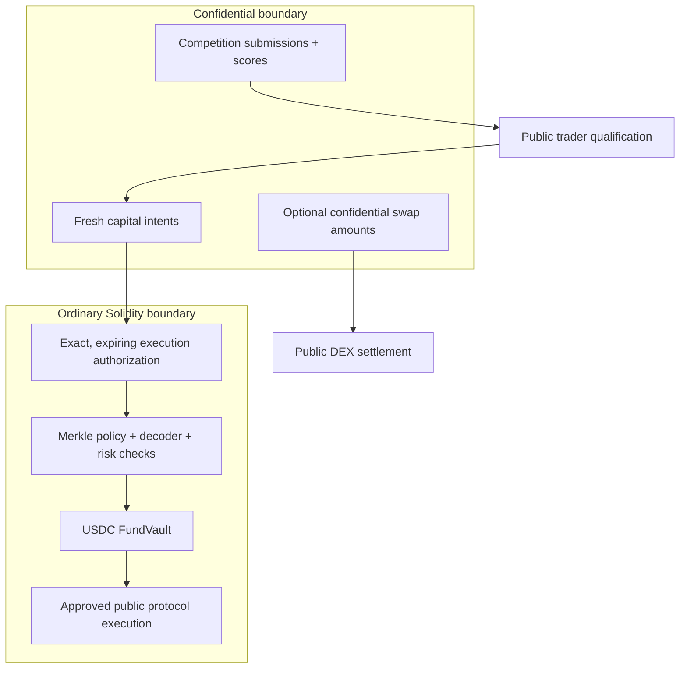
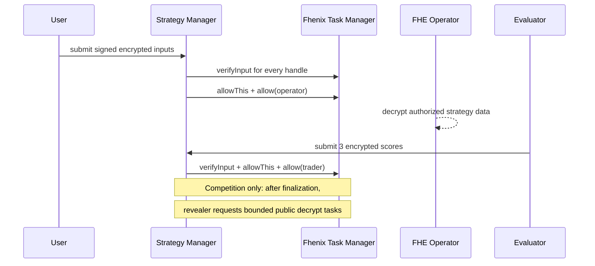

# Fhenix Engineering Review Guide

This guide is the shortest path through AlphaEngine's contract repository for
Fhenix engineering. It supports the permissioned-mainnet admission review
discussed with the Fhenix team:

- confirm that encrypted operations are bounded and economically reasonable;
- understand where Fhenix is used and how often those paths may execute;
- perform a basic contract-security and unexpected-behavior check.

This is **not** a substitute for AlphaEngine's later full internal and
independent external security audits.

## Product in one diagram



AlphaEngine protects strategy information while it is submitted and evaluated.
Qualification applies to the trader—not to a reusable strategy—and never moves
capital automatically. Final vault execution is public and auditable.

Confidential swap is an independent user-facing feature: users may swap an
FHERC20 amount confidentially even if they do not participate in the strategy
or FundVault lifecycle.

## Review routes

| Area | Guide | Primary source |
|---|---|---|
| Competition, qualification, capital | [Strategy README](src/strategy/README.md) | [`src/strategy/`](src/strategy/) |
| Confidential assets and swaps | [Swap README](src/swap/README.md) | [`src/swap/`](src/swap/), [`src/fherc20/`](src/fherc20/) |
| USDC vault and execution policy | [Vault README](src/vault/README.md) | [`src/vault/`](src/vault/), [`src/decoders/`](src/decoders/) |
| Security properties | [Invariant ledger](docs/engineering/invariant-ledger.md) | [`test/invariant/`](test/invariant/) |
| Current limitations and gates | [Audit readiness](docs/audits/fhenix-private-audit-readiness.md) | [Implementation plan](docs/engineering/strategy-manager-fund-vault-implementation-plan.md) |

## FHE operation inventory

### AlphaEngine-owned calls

| Action | Encrypted type | Bounded work in the AlphaEngine contract |
|---|---|---|
| Competition submission with `n` components | `1 + n` × `InEuint128`, `1 <= n <= 16` | `1 + n` input verifications; contract and operator ACL grants for each handle; no encrypted arithmetic |
| Competition evaluation | 3 × `InEuint32` | 3 input verifications; contract and trader ACL grants; no encrypted arithmetic |
| Public score reveal after finalization | 3 × `euint32` per submission | 3 asynchronous decrypt tasks per submission; at most 32 submissions, therefore 96 tasks per call |
| Capital-intent submission | `1 + n` × `InEuint128`, `1 <= n <= 16` | Same input verification and ACL pattern as competition; no encrypted arithmetic |
| Capital evaluation | 3 × `InEuint32` | Same verification and ACL pattern as competition evaluation; no public-decrypt path |
| Confidential-swap submission | 1 × `InEuint64` | 1 input verification plus contract and recorded escrow ACL grants |
| Vault deposit, accounting, Merkle proof, risk check, execution | None | No FHE operations |

`FHE.asEuint128(InEuint128)`, `FHE.asEuint32(InEuint32)`, and
`FHE.asEuint64(InEuint64)` are input-verification calls in the pinned CoFHE
package. They validate type, security zone, and verifier signature, append
metadata, and create transient ACL authority. They do **not** call
`createTask` or perform homomorphic arithmetic. This input proof is the pinned
package's signed-input verification flow; it should not be described as an
AlphaEngine ZK-proof circuit.

The strategy managers contain no FHE add, subtract, multiply, divide, compare,
or select operations. In particular, loading a 128-bit encrypted strategy
field is not a 128-bit encrypted division.

### Inherited FHERC20 work

The swap path uses the official
`fhenix-confidential-contracts@v0.3.1` FHERC20 implementation. A lock, shield,
unshield, settlement, or refund can therefore execute the dependency's bounded
`euint64` balance logic:

- encrypted comparisons (`gte`/`eq`), `select`, addition, and subtraction;
- trivial encryption of constants or shielded plaintext amounts;
- ACL grants and public authorization of the unshield result;
- verification of the published decryption result before underlying transfer.

These operation sequences are branch-dependent—for example, a first mint into
an uninitialized balance differs from a transfer between existing balances.
There is no encrypted division in the reviewed swap path. Wrapper conversion
using `amount / rate` and `amount % rate` is ordinary plaintext Solidity before
or after FHERC20 accounting.

Fhenix should review both AlphaEngine's wrapper extension and the pinned
upstream FHERC20 implementation because the dependency owns the encrypted
balance arithmetic.

## Load and frequency bounds

| Boundary | On-chain bound |
|---|---|
| Encrypted components per strategy submission | 16 |
| Active submissions per competition | 256 |
| Public score-reveal batch | 32 submissions / 96 decrypt tasks |
| Capital execution authorization | Maximum 1 hour |
| FundVault calls per batch | 16 |
| Asset limits per vault execution | 16 |
| Nonzero policy-root activation delay | Minimum 48 hours |

Submission and swap frequency is product-dependent. Role checks and the bounds
above limit work per call, but there is no global on-chain rate limiter for
user submissions. Expected production traffic and Fhenix-side task capacity
should therefore be confirmed during admission review.

## Permissions and decryption



- Operator access is captured at submission; rotating the configured operator
  affects future submissions only.
- Previously granted ciphertext access cannot be cryptographically revoked.
  A compromised operator requires pause, invalidation/cancellation where
  available, rotation, and fresh encrypted submission.
- Competition scores remain encrypted during the competition. After
  finalization, a dedicated role requests asynchronous public decryption of all
  three components. The getter exposes independent readiness flags.
- Capital scores remain available only to the contract and submitting trader.
- The swap operator receives the decrypted input needed for public DEX
  execution; confidential swap protects the user-facing amount before this
  execution boundary, not public settlement effects.

## Custody and execution boundaries

- Strategy managers hold no ERC20 or FHERC20 custody and cannot call arbitrary
  targets.
- Swap escrow holds FHERC20 only for a live intent. The V4 executor is callable
  only by the authorized escrow and must end with no residual underlying.
- `AlphaEngineFundVault` holds pooled USDC and position assets. It contains no
  FHE code.
- Vault calls require an exact Capital Manager commitment plus an active
  per-executor policy root, per-call Merkle proofs, fail-closed decoders, live
  target/decoder code hashes, replay checks, expiry, and spend/receipt limits.
- An executor is a keeper/automation identity that relays an approved bundle;
  it is not automatically the trader and cannot choose uncommitted calls.

## Basic security checkpoints

Reviewers may validate that:

- implementations disable initializers and fresh proxies initialize paused;
- competition, capital, and swap domains have independent roles, storage,
  nonces, pauses, events, and ABIs;
- encrypted handles are internalized and permissioned before storage/use;
- ranks are unique, finalization requires all active submissions to be
  evaluated, and only eligible traders can be qualified;
- capital commitments and swap routes cannot be modified at execution;
- replay markers are written before external vault execution and roll back
  atomically on failure;
- FundVault control-plane addresses cannot be batch targets;
- proofs, decoder results, code hashes, approvals, deltas, and rolling limits
  are checked before execution is accepted;
- refund and emergency paths remain available under their documented pause and
  expiry conditions.

## Dependencies

The review commit must retain these exact submodule SHAs:

| Dependency | Commit | Version/reference |
|---|---|---|
| `cofhe-contracts` | `cb76c99620e1b4acd395e00672be21e48702429f` | `v0.1.3` |
| `fhenix-confidential-contracts` | `0823e57e320c1c72e0caee7faeebc4d3a0710373` | `v0.3.1` |
| OpenZeppelin Contracts | `dbb6104ce834628e473d2173bbc9d47f81a9eec3` | v5 lineage |
| OpenZeppelin Upgradeable | `723f8cab09cdae1aca9ec9cc1cfa040c2d4b06c1` | `v5.0.2` |
| Uniswap v4 core | `e50237c43811bd9b526eff40f26772152a42daba` | `v4.0.0` |

## Known review limitations

- Foundry tests use a repository-owned Task Manager compatibility harness.
  Production Fhenix-network permission/decryption behavior remains a release
  gate.
- `AlphaEngineFHERC20ERC20Wrapper` temporarily extends the official wrapper
  with encrypted-handle unshielding; Fhenix compatibility and the replacement
  trigger require confirmation.
- Stage 17 real-market Pendle enter/hold/exit fork integration is pending.
- Consolidated X-Ray, Solidity Auditor, final fuzzing/remediation, and external
  audit have not yet been completed.
- Deferred confidential-swap hardening hypotheses are tracked in the
  [canonical plan](docs/engineering/strategy-manager-fund-vault-implementation-plan.md#deferred-confidential-swap-hardening-todos)
  and must be resolved or explicitly constrained before release.

## Reproduce the current state

```bash
git submodule update --init --recursive
forge --version
forge fmt --check
forge build --offline
forge test --offline
python3 script/reference/alphaengine_listener_surface.py --check
git diff --check
git submodule status --recursive
```

At handoff, record the exact Git SHA reviewed. Findings and remediation should
reference that immutable SHA; any subsequent code change requires explicit
delta review.

For broader product context, see
[AlphaEngine overview](https://docs.alphaengine.trade/overview/alphaengine.md),
[private strategy evaluation](https://docs.alphaengine.trade/architecture/private-strategy-evaluation-flow.md),
and [public settlement](https://docs.alphaengine.trade/trust/public-settlement.md).
