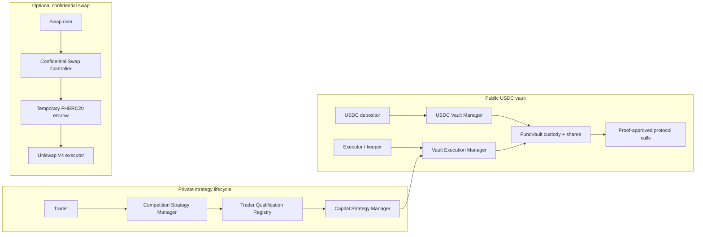

# AlphaEngine Contracts

> **Private strategies. Open competition. Better yield.**

AlphaEngine is a confidential alpha network for on-chain finance. This
repository contains the Solidity contracts for three deliberately separate
surfaces:

1. private strategy competition and capital authorization;
2. a public, USDC-denominated yield vault with policy-constrained execution;
3. optional user-facing confidential swaps.

The public product documentation at [docs.alphaengine.trade](https://docs.alphaengine.trade/)
provides product context. This repository is the source of truth for the
implemented contract architecture and security boundaries.

## Start here

| Reader | Guide |
|---|---|
| Fhenix engineering reviewer | [Fhenix review guide](FHENIX_REVIEW.md) |
| Strategy and FHE lifecycle | [Strategy contracts](src/strategy/README.md) |
| Confidential swap lifecycle | [Swap contracts](src/swap/README.md) |
| Vault accounting and execution | [Vault contracts](src/vault/README.md) |
| Detailed implementation decisions | [Canonical implementation plan](docs/engineering/strategy-manager-fund-vault-implementation-plan.md) |
| Test design and security properties | [Testing strategy](docs/engineering/testing-strategy.md) and [invariant ledger](docs/engineering/invariant-ledger.md) |

## System map



Competition qualification makes a **trader eligible**; it never approves a
strategy or allocates funds automatically. Every capital intent is submitted
and evaluated independently, then bound to one exact, expiring execution
commitment. Vault execution additionally requires an active Merkle policy,
valid call proofs, decoder approval, live code-hash checks, and risk limits.

The confidential-swap path is an independent product. It does not execute
FundVault capital and can be deployed or paused separately.

## Component ownership

| Area | Primary contracts | Boundary |
|---|---|---|
| Competition | `AlphaEngineCompetitionStrategyManager` | Encrypted submissions and scores, public ranks, post-finalization score reveal |
| Qualification | `AlphaEngineTraderQualificationRegistry` | Versioned, expiring, revocable trader eligibility |
| Capital | `AlphaEngineCapitalStrategyManager` | Fresh encrypted intents and exact one-time execution authorization |
| Vault accounting | `AlphaEngineFundVault`, `AlphaEngineUSDCVaultManager` | USDC custody, shares, deposits, asynchronous redemptions, reported P&L and fee vesting |
| Vault execution | `AlphaEngineVaultExecutionManager`, decoders | Merkle policy, replay protection, calldata checks and trader/asset limits |
| Confidential swap | controller, escrow, asset registry/gateway, FHERC20 wrapper, V4 executor | Bound route execution and temporary confidential custody |

## FHE boundary

- Strategy contracts verify `externalEuint128` batches with one proof, register access, and
  store encrypted `euint32` evaluation scores. They perform no encrypted
  arithmetic or encrypted division.
- Competition scores can be requested for asynchronous public decryption only
  after finalization, in bounded batches.
- Confidential swaps use `euint64` FHERC20 amounts. The AlphaEngine controller
  verifies and permissions the input; the official FHERC20 dependency performs
  bounded encrypted balance operations.
- Vault accounting, Merkle verification, risk checks, and protocol execution
  use ordinary Solidity and contain no FHE operations.

See [FHENIX_REVIEW.md](FHENIX_REVIEW.md) for the operation inventory, limits,
permission graph, dependencies, and reproduction commands.

The current dependency revision uses CoFHE v1.0.0 and FHERC20 v0.4.0. Encrypted
input ABIs, handle sharing and wrapper claim IDs require consumer migration;
see the [migration notes](docs/engineering/cofhe-v020-migration.md).
The 1.0.0 address-book adaptation and no-broadcast deployment preparation are
recorded in the [October 8 rehearsal](docs/engineering/deployment-rehearsal-2026-10-08.md).

## Implementation status

Implementation is complete through **Stage 16** of the canonical plan:

- separate competition, qualification, capital, and confidential-swap paths;
- USDC FundVault accounting with immediate deposits and asynchronous redemption;
- ERC20, ERC4626, and current Pendle RouterV4 PT decoder/sanitizers;
- deterministic Merkle policy artifacts and the immutable vault execution manager;
- focused unit, fuzz, invariant, and integration coverage for each stage.

The strategy/confidential-swap core was deployed to Arbitrum Sepolia on
9 October 2026; see the [addresses and receipt record](docs/engineering/deployment-arbitrum-sepolia-2026-10-09.md).
The subsequent [Arbitrum One deployment record](docs/engineering/mainnet-preparation-2026-10-16.md)
documents the October 16 deployment, explorer source verification, and accepted
bootstrap-admin handover. The [October 22 competition confirmation](docs/engineering/mainnet-competition-activation-2026-10-22.md)
records operational-role setup, removal of the old bootstrap's competition
permissions, and an active competition with the manager and registry unpaused.
These are dated deployment observations, not a fresh live-state check.

The [October 16 internal source review](docs/audits/internal-review-2026-10-16.md)
at `7ed4c49` completed X-Ray, a requirements-to-existing-fuzz review, and one
Solidity Auditor pass: zero confirmed findings and five unscored leads. It was
an internal AI-assisted review, not an independent external security audit.

FundVault and per-asset wrappers remain undeployed. Mainnet encrypted-flow
integration checks, final Safe/timelock governance handover, Stage 17 real-market
Pendle enter/hold/exit fork integration, independent external review, and the
remaining product-specific release gates are still open. This codebase must
not be described as production-ready or externally audited.

## Build and verify

Canonical CI Foundry release: `v1.8.5`.

```bash
git submodule update --init --recursive
forge fmt --check
forge build --offline
forge test --offline
python3 script/reference/alphaengine_listener_surface.py --check
git diff --check
```

CI also runs checksum-pinned Gitleaks `v8.30.1` over all fetched Git history,
including deleted files. To reproduce with that version installed:

```bash
gitleaks git --no-banner --redact=100 --log-opts="--all --full-history" .
bash script/ci/check-repository-hygiene.sh
```

Release profiles increase fuzz and invariant runs; see
[testing-strategy.md](docs/engineering/testing-strategy.md). Generated listener
ABIs live under [`ABI/v2/`](ABI/v2/), and deployment/cutover behavior is
documented under [`docs/migrations/`](docs/migrations/).

## Historical evidence

The retired mixed `AlphaEngineIntentController` and
`AlphaEngineConfidentialVault` are no longer active source. Their manifest,
ABI, layouts, addresses, and Git history remain preserved as historical
evidence. Fresh contracts use independent storage, nonces, pause domains,
roles, ABIs, and deployment addresses; no legacy storage is reinterpreted.

## License and security

AlphaEngine-authored code is available under the [MIT License](LICENSE).
Third-party dependencies retain their own licenses and notices.
See [SECURITY.md](SECURITY.md) for private vulnerability reporting and review
limitations.
