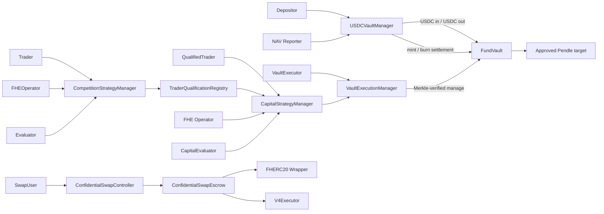
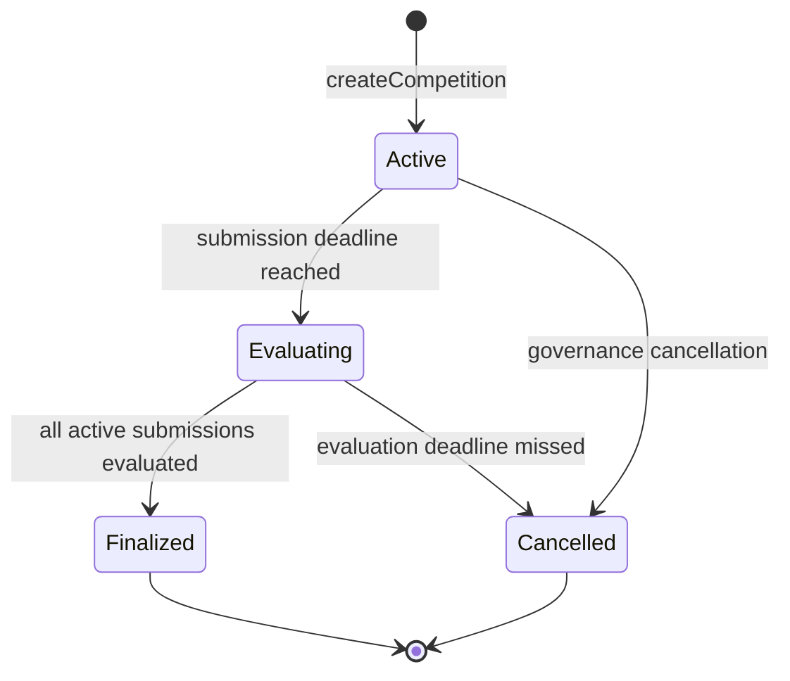

# AlphaEngine Strategy Manager, Confidential Swap, and FundVault Plan

## 1. Summary and deliverable status

The recommended architecture uses independent contracts for competition, capital deployment, confidential swaps, and custody:

- `AlphaEngineCompetitionStrategyManager`
- `AlphaEngineTraderQualificationRegistry`
- `AlphaEngineCapitalStrategyManager`
- `AlphaEngineConfidentialSwapController`
- `AlphaEngineConfidentialSwapEscrow`
- Second pass: `AlphaEngineFundVault`, `AlphaEngineUSDCVaultManager`, and
  `AlphaEngineVaultExecutionManager`

Competition and capital managers share only interfaces and stateless hashing libraries. They do not inherit a storage-bearing `BaseStrategyManager`.

Implementation status as of 2026-08-27: Stages P0 through 11 are implemented.
Stage 7 adds the append-only confidential asset registry, non-custodial
shield/unshield gateway, and fresh upgradeable swap escrow. Stage 8 adds the
fresh bound swap controller, exact execution-data and salted minimum-output
reveal checks, combined controller/escrow invariants, and fresh-path
PoolManager differential parity. Work is paused at the required owner-review
checkpoint before Stage 12 Fund accounting specification; no external deployment has
occurred. Stage 9 added fresh paused deployment, independent ProxyAdmin,
versioned manifest, explicit delayed-admin action, selector/topic snapshot,
and listener-cutover tooling. Superseded active legacy Solidity/tests/scripts
were removed while their manifest, ABI, layouts, addresses, and Git history
were preserved.

Stage 10 completed the full local integration/release gate: 173 tests, release
fuzz and invariant profiles, PoolManager differential integration, local
deployment rehearsal, generated ABI/layout/listener parity, runtime sizes,
repository hygiene, and production coverage above 90% for lines and
statements. Evidence is saved in
`docs/releases/stage-10-first-pass-integration-validation.md`.

Stage 11 records `365b3e668217b1f1ca4caede9e6b8fb60526d430` as
the first-pass implementation checkpoint in
`docs/releases/first-pass-implementation-checkpoint.md`. It is a traceability
marker, not a public deployment, external-audit freeze, or production-readiness
claim.

The Stage 5 Competition Manager has also been refined with the owner-approved
post-finalization reveal flow: a dedicated role requests asynchronous public
decryption of all three score components in bounded rank-order batches, and a
readiness-aware getter reads the verified CoFHE results without duplicating
plaintext in manager storage.

Locked decisions:

- Preserve the current v1 encrypted market/component schema and three encrypted evaluation scores.
- Keep all three evaluation scores private during the competition, then allow a
  dedicated score revealer to request asynchronous public decryption in bounded
  rank-order batches after finalization. Do not add a separate aggregate score.
- Use versioned, expiring trader qualification.
- Bind swap execution parameters at submission.
- Launch the first FundVault as a public, USDC-denominated, share-based vault.
- Keep custody and the share ledger in `AlphaEngineFundVault`.
- Use `AlphaEngineUSDCVaultManager` as the only public deposit, withdrawal,
  daily NAV-reporting, and share-pricing surface. It combines only the USDC
  portions of Teller and Accountant behavior; it is not a second custodian.
- Use `AlphaEngineVaultExecutionManager` as the separate Merkle-verified fund
  deployment surface. It cannot mint or burn shares, process deposits or
  withdrawals, or update NAV.
- Accept only USDC in the initial release. Defer multi-asset deposit conversion,
  deposit-asset oracles, the full Veda Teller/Accountant stack, leverage,
  borrowing, flash loans, bridges, and generic routers.
- Calculate daily NAV as USDC-denominated net liquidation value from on-chain
  positions at a declared reference block, after realized costs, expected exit
  costs, protocol costs, and liabilities.
- Vest positive reported P&L over 24 hours. Apply confirmed losses immediately,
  first against unvested positive P&L and then against recognized share value.
- Launch fund deployment with Pendle PT actions only.
- Use Safe-controlled roles plus enforced timelocks in production.
- Use fresh proxies and addresses; preserve the legacy deployment and manifest unchanged.

This file is the canonical implementation plan and must be consulted before
each bounded stage. First-pass implementation is already in progress; the
FundVault components remain second-pass design scope until their stage begins.
Every stage stops at its checkpoint for owner review before the next stage.
Documentation changes do not authorize a testnet or production deployment.

## 2. Current-state assessment

Baseline: `49d96e8a80d6903d1d30affc6f836bcc0ac13800`.

### Architectural debt

| Area | Current state | Required correction |
|---|---|---|
| Strategy and swap | One `AlphaEngineIntentController` owns both lifecycles | Separate contracts, storage, nonces, pauses, events, roles, and ABIs |
| Strategy lifecycle | Submission, encrypted scores, and cancellation only | Explicit competition, ranking, qualification, capital approval, rejection, expiry, revocation, and consumption |
| Authority | One `listenerOperator` decrypts, evaluates, and executes swaps | Separate FHE operator, evaluator, qualifier, swap operator, and vault executor authorities |
| Qualification | Not implemented | Trader-level, expiring, versioned, revocable registry |
| Capital authorization | Not implemented | Exact, one-time execution commitment tied to vault, manager, chain, calls, risk envelope, root, nonce, and expiry |
| Swap execution | Operator chooses uncommitted output wrapper, minimum output, calldata, and current executor | Pin executor/output wrapper and commit calldata and salted minimum output during submission |
| Swap vault naming | `AlphaEngineConfidentialVault` is actually a gateway and transient escrow | Replace with explicit asset registry/gateway and `AlphaEngineConfidentialSwapEscrow` |
| Contract size | Current vault runtime is 23,746 bytes, only 830 bytes below EIP-170 | Split registry/gateway behavior from escrow; require at least 1,500 bytes runtime margin |
| Storage | Mixed controller uses slots 0–7 and one shared gap | Fresh proxies; no reinterpretation or migration |
| ABI | Checked-in controller ABI omits current evaluation functions, event, and errors | Archive baseline ABI and add source-generated selector/topic parity gates |
| Deployment | Combined scripts, no vault upgrade test, upgrade script does not enforce manifest chain ID | Independent scripts, wrong-chain rejection, golden deployment tests, versioned manifests |
| CI | No `.github/workflows`; Foundry is an unpinned nightly | Pin a verified stable toolchain and add full CI gates |
| Formatting | `forge fmt --check` currently fails | Isolated non-behavioral cleanup before contract development |
| Veda reference | Local POC is dirty, incomplete, and of uncertain provenance | Architecture reference only; independently design AlphaEngine implementation unless licensed |
| Fund custody and accounting | Earlier plan assumed a shareless treasury vault | Public USDC-only vault with separate custody/share, deposit/NAV, and Merkle-execution authority domains |

The legacy combined proxy and escrow must not be upgraded into any new component. Their addresses, implementation slots, storage layouts, manifest, events, and final indexed block remain historical evidence.

## 3. Final component map

### First pass

| Component | Upgrade model | Purpose |
|---|---|---|
| `AlphaEngineTraderQualificationRegistry` | Fresh transparent proxy | Canonical trader qualification, expiry, versioning, and revocation |
| `AlphaEngineCompetitionStrategyManager` | Fresh transparent proxy | Competition scheduling, encrypted submissions/evaluation scores, plaintext ranking, post-finalization asynchronous public score reveal, and qualification publication |
| `AlphaEngineCapitalStrategyManager` | Fresh transparent proxy | Qualified-trader encrypted intents, independent evaluation, exact approvals, rejection, revocation, expiry, and one-time authorization consumption |
| `AlphaEngineStrategyHashLib` | Stateless library | Competition/capital identifiers and payload hashing |
| `AlphaEngineExecutionHashLib` | Stateless library | Ordered calls, risk envelope, and execution-commitment hashing |
| `AlphaEngineConfidentialAssetRegistry` | Non-upgradeable | Immutable wrapper/underlying registry and wrapper creation |
| `AlphaEngineConfidentialAssetGateway` | Non-upgradeable/stateless | User deposit/shield and ordinary request/claim convenience surface |
| `AlphaEngineConfidentialSwapController` | Fresh transparent proxy | Bound confidential swap submission, execution, refund, nonce, operator, and pause lifecycle |
| `AlphaEngineConfidentialSwapEscrow` | Fresh transparent proxy | FHERC20 lock, unshield, settlement, refund, and custody accounting |
| `AlphaEngineFHERC20ERC20Wrapper` | Existing non-upgradeable pattern | Temporary encrypted-amount unshield bridge |
| `AlphaEngineV4SwapExecutor` | Fresh non-upgradeable deployment | Bounded Uniswap v4 exact-input execution |

### Second pass

| Component | Upgrade model | Purpose |
|---|---|---|
| `AlphaEngineFundVault` | Non-upgradeable | Custody of USDC and deployed positions, ERC20 share ledger, role-gated entry/exit settlement, and execution-manager-only atomic calls |
| `AlphaEngineUSDCVaultManager` | Non-upgradeable | Public USDC deposits, checkpoint settlement, withdrawals, daily NAV reports, share pricing, positive-P&L vesting, and immediate loss recognition |
| `AlphaEngineVaultExecutionManager` | Non-upgradeable | Capital authorization, Merkle proofs, root governance, replay protection, risk envelopes, and vault orchestration |
| `IAlphaEngineDecoderAndSanitizer` | Interface | Fail-closed protocol calldata inspection |
| `AlphaEngineERC20DecoderAndSanitizer` | Non-upgradeable | Exact approvals/reset, FundVault receiver checks, and withdrawal-reserve unwind checks |
| `AlphaEnginePendlePtDecoderAndSanitizer` | Non-upgradeable | Narrow exact-token-for-PT action validation |
| `GenerateAlphaEngineManageRoot` | Foundry script | Deterministic leaf, tree, proof, and human-readable policy artifact generation |



## 4. Responsibilities and prohibited responsibilities

| Contract | Owns | Must never own |
|---|---|---|
| Qualification Registry | Trader validity, version, expiry, evidence source, revocation | Encrypted strategies, rankings, approvals, custody, protocol calls |
| Competition Manager | Competition config, encrypted submissions, encrypted scores, ranks, qualification eligibility | Capital approvals, vault access, swap state, token custody |
| Capital Manager | Encrypted capital intents, evaluations, immutable execution commitments, consumption state | Competition ranking, Merkle roots, arbitrary calls, token custody |
| Asset Registry | Wrapper registration and immutable wrapper/underlying association | User balances, swap locks, execution |
| Asset Gateway | Stateless shield/unshield convenience | Persistent custody, wrapper mutation, strategy state |
| Swap Controller | Swap records, bound route commitments, execution/refund status | Strategy state, pooled capital, protocol-specific imports |
| Swap Escrow | Temporary confidential custody, lock/unshield/settle/refund accounting | Competition/capital state, pooled LP funds, route selection |
| V4 Executor | Exact-input V4 mechanics | Strategy evaluation, custody bookkeeping, arbitrary callers |
| FundVault | USDC and position custody, ERC20 share ledger, USDC-manager-only entry/exit settlement, execution-manager-only atomic batches | FHE, qualification, evaluation, NAV calculation, public request handling, Merkle-root governance |
| USDC Vault Manager | Public USDC deposit requests, checkpoint settlement, withdrawal requests/reserves/settlement, NAV reports, share-price accounting, gain vesting, and loss recognition | Long-lived custody, strategy evaluation, Merkle roots, arbitrary protocol calls, multi-asset conversion |
| Vault Execution Manager | Root policy, exact capital authorization, decoder/proof checks, risk limits, replay, and vault orchestration | Strategy evaluation, trader qualification, share mint/burn, deposits, withdrawals, NAV updates, long-lived custody |
| Decoders | Fail-closed calldata inspection | Mutable state, token custody, arbitrary external actions |
| Root generator | Reproducible policy artifacts | On-chain authority or production secrets |

No owner, trader, evaluator, NAV reporter, executor EOA, or root administrator
receives a direct arbitrary-call role on `AlphaEngineFundVault`. The USDC
manager receives only entry/exit selectors; the execution manager receives only
the bounded atomic-call selector. Those authorities are not interchangeable.

## 5. State machines

### Competition



Submission lifecycle:

```text
Unset → Submitted → Cancelled
                  → Evaluated
```

Rules:

- Maximum 256 active submissions per competition.
- One active submission per trader per competition; cancellation permits a fresh resubmission with a new nonce.
- Maximum 16 encrypted strategy components.
- Evaluation is terminal and can occur once.
- Ranks are plaintext, nonzero, unique, and bounded by active submission count.
- Finalization requires `evaluatedCount == activeSubmissionCount`.
- Eligibility is deterministic: `rank <= qualificationSlots`.
- Qualification is published only after competition finalization.
- No qualification is attached to a strategy; publication grants the trader a registry record.

Qualification lifecycle:

```text
Unqualified → Qualified(version=1, validUntil)
Qualified → Extended(same version, later validUntil)
Qualified → Revoked(version++)
Expired/Revoked → Qualified(version++, new validUntil)
```

Capital intents store the active qualification version. A revoked or expired version can never be revived by later requalification.

### Capital

```text
Unset → PendingEvaluation → Cancelled
                          → Rejected
                          → Approved → Consumed
                                     → Revoked
                                     → Expired
```

Rules:

- Submission, approval, and consumption each recheck qualification validity and exact version.
- Changing any execution field requires revocation and a fresh encrypted capital intent.
- Trader cancellation remains available while paused.
- Evaluator/governance revocation remains available while paused.
- `expireCapitalIntent` is permissionless after the applicable deadline.
- Downstream vault failure atomically rolls back consumption.

### Confidential swap

```text
Unset → Active → Executed
               → Refunded
```

Escrow lifecycle:

```text
Unset → Locked → UnshieldRequested → Consumed
                                  → Refunded
```

Rules:

- Locking immediately requests encrypted unshield; no user-cancel state is introduced.
- An insufficient-balance confidential transfer may create an initialized
  encrypted-zero lock. A verified zero result cannot execute a swap, but the
  refund path must claim and terminate it without attempting a zero-value
  re-shield.
- Because wrapper claims are permissionless and pay a fixed recipient, an
  already-claimed input is reconciled from escrow custody after verifying the
  exact claim handle, recipient, decrypted amount, and available underlying.
- Execution is operator-only and must occur before expiry.
- Refund is permissionless after expiry or while controller/escrow is paused.
- Refund and output always return to the recorded original trader.
- The dead legacy `Unlocked` state is removed.
- Existing canonical FHERC20 returned-handle behavior is preserved.

### USDC deposits and withdrawals

Deposit lifecycle:

```text
Unset → Requested → Priced → Settled
                  → Cancelled
```

Withdrawal lifecycle:

```text
Unset → Requested → LiquidityPending → PricedAndReserved → Settled
                  → Cancelled
```

Rules:

- Deposits are USDC-only and settle at the next daily NAV checkpoint. This is
  the initial anti-dilution rule; deposits cannot enter at a stale recognized
  price and capture positive P&L earned before their checkpoint.
- Pending deposit USDC is held by the FundVault but segregated from active NAV
  by USDC-manager accounting until shares are minted at settlement.
- A depositor may cancel only before pricing. Cancellation returns exactly the
  pending principal and cannot use assets belonging to existing shareholders.
- Withdrawal shares are escrowed on request. If idle USDC is insufficient, the
  request remains `LiquidityPending` while an approved strategy unwind returns
  USDC to the FundVault. Pricing, share burning, and USDC reservation then occur
  atomically at a daily NAV checkpoint; no unfunded fixed-value claim is created.
- Reserved USDC cannot be redeployed. If idle USDC is insufficient, an approved
  unwind must return assets to the FundVault before settlement.
- Withdrawal settlement is permissionless once the request is reserved and the
  FundVault has sufficient USDC.
- The USDC manager cannot retain USDC beyond an atomic call boundary.
- Deposit/withdrawal operations have a pause domain independent from strategy
  execution; emergency policy must still permit safe user exits.

### Daily NAV and yield recognition

```text
Unreported → Reported → PositiveGainVesting → FullyRecognized
                      → LossRecognizedImmediately
```

Rules:

- Each report binds a strictly increasing finalized reference block,
  methodology version/hash, net NAV, total share supply, and external-flow
  counters.
- Positive P&L vests linearly over 24 hours and is not immediately redeemable.
- A confirmed loss first cancels unvested positive P&L, then reduces recognized
  share value immediately.
- A new report settles the previously elapsed vesting before applying the next
  period's P&L.
- Stale, non-monotonic, economically impossible, or configured outlier reports
  revert and may trigger a pause.
- NAV reporting never transfers assets and never authorizes execution.

## 6. Public interfaces, identifiers, and hashes

All hashes use `abi.encode`, never packed encoding of dynamic values. Fixed-vector tests must independently compute every value in Solidity and one off-chain implementation.

### Identifiers

```solidity
COMPETITION_ID_V1_TYPEHASH =
    keccak256(
        "AlphaEngineCompetitionIdV1(uint256 chainId,address manager,uint64 competitionNonce,bytes32 rulesHash)"
    );

COMPETITION_SUBMISSION_ID_V1_TYPEHASH =
    keccak256(
        "AlphaEngineCompetitionSubmissionIdV1(uint256 chainId,address manager,bytes32 competitionId,address trader,uint64 traderNonce)"
    );

CAPITAL_INTENT_ID_V1_TYPEHASH =
    keccak256(
        "AlphaEngineCapitalIntentIdV1(uint256 chainId,address manager,address trader,uint64 traderNonce)"
    );

SWAP_INTENT_ID_V1_TYPEHASH =
    keccak256(
        "AlphaEngineSwapIntentIdV1(uint256 chainId,address controller,address trader,uint64 traderNonce)"
    );
```

Each family has its own nonce mapping. A nonce increases exactly once if and only if submission succeeds.

### Strategy payloads

```text
componentsHash = keccak256(abi.encode(componentHandles))
```

Competition payload binds:

- chain ID;
- manager;
- competition submission ID;
- competition ID;
- trader;
- trader nonce;
- encrypted market handle;
- timeframe key;
- competition evaluation deadline;
- ordered component-handles hash.

Capital payload binds the equivalent fields plus the qualification version and capital-intent deadline.

`createdAt`, transaction hash, log index, and current operator are excluded from replay-critical hashes. The operator snapshot is stored separately for auditability.

### Call and risk hashes

```solidity
callHash[i] = keccak256(
    abi.encode(
        CALL_V1_TYPEHASH,
        i,
        decoder[i],
        target[i],
        value[i],
        keccak256(targetData[i])
    )
);

callsHash = keccak256(
    abi.encode(
        CALLS_V1_TYPEHASH,
        callCount,
        keccak256(abi.encode(callHashes))
    )
);
```

Risk limits are sorted by ascending asset address and may not contain duplicates:

```solidity
assetLimitHash[i] = keccak256(
    abi.encode(
        ASSET_DELTA_LIMIT_V1_TYPEHASH,
        i,
        asset,
        maxSpend,
        minReceive
    )
);

riskEnvelopeHash = keccak256(
    abi.encode(
        RISK_ENVELOPE_V1_TYPEHASH,
        limitCount,
        keccak256(abi.encode(assetLimitHashes)),
        uint256(0) // initial release permits no native value
    )
);
```

### USDC NAV and share-accounting specification

The initial vault has one accounting unit and one accepted deposit asset: USDC.
The authoritative report definition is:

```text
reportedNetNav =
    idleActiveUSDC
  + sum(netLiquidationValueUSDC(position[i]))
  + claimableRewardsUSDC
  - accruedLiabilitiesUSDC

periodPnL =
    reportedNetNav
  - previousReportedNetNav
  - activatedDepositsSincePreviousReport
  + accountedWithdrawalsSincePreviousReport
```

`netLiquidationValueUSDC` means the amount reasonably recoverable in USDC at
the declared reference block after realized execution costs, current expected
exit costs, slippage under the versioned methodology, protocol costs, and any
vault-borne liabilities. Pending deposits and USDC reserved for withdrawals are
not active strategy NAV. Gas is included only when the FundVault pays or
reimburses it.

Accounting rules:

- The NAV calculator runs off-chain from public on-chain state. The on-chain
  NAV reporter submits only the aggregate result and reproducibility metadata;
  it cannot move funds or approve calls.
- The report transaction and role authorization are sufficient for the initial
  release; a separate signed reproducibility report is not required. A public
  transparency artifact should reproduce positions, valuation inputs, costs,
  and the aggregate result.
- `referenceBlock` must be finalized, strictly newer than the prior report, and
  no newer than the configured maximum reporting lag.
- Share-rate calculations use explicit USDC decimals, deterministic rounding,
  and fixed formula-lock vectors. Deposits round shares down; withdrawals round
  required burned shares up. Rounding residue remains with the vault.
- Shares use 18 decimals. Conversion includes fixed virtual liquidity:
  `virtualAssets = 1e6` USDC units and `virtualShares = 1e18` share units, so
  the initial economic rate is exactly one USDC per whole share and a direct
  donation cannot create a zero-supply price singularity. These constants are
  immutable and formula-tested.
- At each checkpoint, process in this order: settle elapsed vesting; accept the
  new NAV report and derive P&L; establish economic and recognized share rates;
  price eligible withdrawals at the recognized rate; then price eligible
  deposits at the post-report economic rate. Adding settled deposit principal
  increases both recognized and economic NAV by the same amount, so a new
  depositor pays for already-earned unvested gains without receiving free
  historical yield.
- Positive `periodPnL` enters a 24-hour linear vest. It increases economic NAV
  immediately for reporting but increases redeemable/recognized NAV only as it
  vests.
- Negative `periodPnL` reduces unvested positive P&L first and then recognized
  NAV immediately. A loss can never be deferred behind the vesting schedule.
- PT redemption is a change in asset composition. Only the difference between
  redemption proceeds and the position's previously reported net value is new
  P&L. Redeployment fees and slippage appear in the next post-transaction NAV.
- The initial release does not use a Chainlink feed for deposits because both
  deposit asset and accounting unit are USDC. Any future USDT, ETH, or BTC
  deposit adapter is a separately planned module that converts to actual USDC
  before minting and may use independent oracle bounds.
- Protocol/performance fee charging is out of scope for the initial release.
  The liability term remains defined for actual protocol obligations and a
  future separately audited fee module.

The exact storage representation for vested/unvested values may be optimized
during the bounded accounting stage, but it must implement these equations and
rounding directions without changing their economics.

`activatedDepositsSincePreviousReport` increments only when pending USDC becomes
active vault capital and shares are minted. `accountedWithdrawalsSincePreviousReport`
increments when shares are burned and the immutable USDC claim becomes a
segregated reserve; later transfer of that reserve to the user is not a second
external flow.

### Execution commitment

```solidity
executionCommitment = keccak256(
    abi.encode(
        EXECUTION_COMMITMENT_V1_TYPEHASH,
        block.chainid,
        address(capitalStrategyManager),
        address(vaultExecutionManager),
        address(fundVault),
        intentId,
        trader,
        qualificationVersion,
        executor,
        authorizationNonce,
        validAfter,
        deadline,
        policyRoot,
        policyVersion,
        callsHash,
        riskEnvelopeHash,
        riskPolicyVersion,
        submissionPayloadHash,
        evaluationEvidenceHash
    )
);
```

Mandatory properties:

- `validAfter < deadline <= capitalIntent.deadline`.
- Maximum authorization window: one hour.
- `authorizationNonce` is globally unique within the capital manager.
- The current root, root version, risk-policy version, qualification version, manager, vault, executor, chain, and commitment must match at consumption.
- The commitment and authorization nonce are marked consumed before external execution.
- Proofs are not hashed; the root and exact leaf inputs are.
- Cross-chain execution is out of scope. A later LayerZero pathway requires a separate destination verifier binding source chain, source sender, message nonce, destination manager, and destination replay state.

### Swap binding

At submission, the user provides:

- input and output wrappers;
- opaque `routeKey`;
- `keccak256(executionData)`;
- a salted minimum-output commitment;
- encrypted input;
- deadline.

```solidity
minimumOutputCommitment = keccak256(
    abi.encode(
        SWAP_MIN_OUTPUT_V1_TYPEHASH,
        intentId,
        minimumOutput,
        salt
    )
);
```

The record pins the current escrow and executor. Execution reveals `executionData`,
`minimumOutput`, and `salt`; any mismatch reverts. Client tooling must generate a
cryptographically random 32-byte salt. The committed minimum applies to total measured
underlying output before confidential precision conversion. If the output wrapper rate exceeds
one, settlement shields the largest exact rate multiple and returns the remainder directly to
the original trader, so `total output == shielded units * rate + returned dust` and the escrow
retains no remainder.

## 7. FHE internalization and permissions

For competition and capital submissions:

1. Internalize every `InEuint128` using `FHE.asEuint128`.
2. Reject zero/uninitialized resulting handles.
3. Call `FHE.allowThis` for every handle.
4. Grant access to the manager’s `fheOperator` snapshot.
5. Store and emit only canonical `bytes32` handles.
6. Store `operatorAtSubmission`.
7. Internalize evaluator-provided `InEuint32` scores.
8. Grant score-handle access to the contract and submitting trader.
9. Assert permissions directly against the Fhenix task manager in tests.

Operator rotation affects only future submissions. Existing access cannot be cryptographically revoked. If an operator is compromised:

- pause new submissions immediately;
- cancel or invalidate pending submissions;
- rotate the configured operator through governance;
- require fresh encrypted resubmission;
- disclose that already-authorized ciphertext may already have been decrypted.

The local CoFHE mock validates repository logic but does not prove production cryptography. A production Fhenix-network permission/decryption test remains a release gate.

## 8. Roles and authority

Production defaults:

- 48-hour delay for upgrades, nonzero root activation, role/config expansion, and unpause.
- Immediate pause and zero-root revocation.
- Each proxy has an independent `ProxyAdmin`.
- Testnet role collapse is allowed only when explicitly marked `testOnlyRoleCollapse: true` in the manifest.

| Authority | Recommended holder | Allowed | Prohibited |
|---|---|---|---|
| Owner/default admin | Protocol Timelock controlled by Governance Safe | Role/config administration | Daily evaluation or execution |
| Upgrader | Per-proxy `ProxyAdmin`, owned by Upgrade Timelock | Upgrade one named proxy | Evaluation, pause, execution |
| Pauser | Emergency Safe | Immediate pause | Unpause, root installation, upgrade |
| FHE operator | Dedicated service/TEE key per manager | Decrypt newly submitted handles | Evaluate, qualify, approve, custody |
| Competition evaluator | Dedicated service or evaluator Safe | Record scores, evidence, and ranks | Publish arbitrary qualification or access capital |
| Score revealer | Dedicated keeper/service | Request asynchronous public decryption of finalized score handles in bounded rank-order batches | Change scores, ranks, evidence, or reveal before finalization |
| Qualifier/finalizer | Qualification Safe | Finalize complete competitions | Alter ranks or capital approvals |
| Qualification issuer | Competition manager contract | Publish eligible traders to registry | Direct EOA qualification |
| Qualification revoker | Emergency Safe/governance | Revoke compromised traders | Approve capital |
| Capital evaluator | Capital approval Safe/service | Reject or approve exact commitments | Execute vault calls or set roots |
| Swap operator | Swap-only service key | Execute committed swaps | Change execution commitment or administer strategy |
| Trader | User | Submit/cancel own eligible intent | Direct vault access |
| Root proposer | Root Safe | Propose root plus artifact hash | Immediate activation |
| Root activator | Anyone after delay | Activate exact pending root | Modify proposal |
| Root guardian | Emergency Safe | Set active root to zero and pause | Install nonzero root |
| Vault executor | Automation service | Submit exact approved bundle and proofs | Approve intent, set root, bypass manager |
| NAV reporter | Dedicated reporting service/Safe | Submit bounded NAV reports for finalized blocks | Move assets, execute strategies, set roots, mint shares directly |
| USDC settlement operator | Permissionless after checkpoint conditions, with bounded keeper for liveness | Price/settle eligible deposit and withdrawal requests | Choose NAV, alter recipients, execute protocol calls |
| FundVault accounting manager | `AlphaEngineUSDCVaultManager` | Invoke only entry/exit settlement selectors | Invoke `manage`, set roots, evaluate strategies |
| FundVault execution manager | `AlphaEngineVaultExecutionManager` | Invoke only the atomic `manage` selector | Mint/burn shares, process deposits/withdrawals, report NAV |
| Recovery authority | Emergency Safe | Pause and migrate supported assets only to a precommitted replacement custody vault that preserves shareholder claims | Send assets to treasury or choose an arbitrary recipient |

The same production signer must not simultaneously control admin, evaluator, root, and execution authority.

## 9. Threat model

| Threat | Mandatory controls | Residual risk |
|---|---|---|
| Compromised owner/admin | Timelock, separate roles, initial paused state, event monitoring | Governance ultimately controls configuration |
| Compromised upgrader | Separate ProxyAdmins, Safe+delay, golden layout and code-hash checks | Authorized upgrade can replace logic |
| Compromised pauser | Pauser cannot unpause or move funds | Denial of service |
| Compromised FHE operator | No evaluation/custody role, short intent windows, emergency pause/resubmission | Previously granted ciphertext access cannot be revoked |
| Compromised evaluator | Separate execution/root roles, exact evidence and finite authorization | Off-chain evaluation remains trusted |
| Malicious trader | Qualification gating, bounds, proof validation, exact commitments, no vault role | Gas/state spam paid by trader |
| Compromised root administrator | Delayed nonzero root, artifact review, immediate zero-only emergency action | Timelocked governance can eventually broaden policy |
| Compromised vault executor | Exact commitment, root proof, risk envelope, one-time consume | Executor can choose transaction timing within validity window |
| Compromised NAV reporter | Finalized-block binding, strict monotonicity, methodology hash, report bounds, 24-hour positive vest, immediate pause | A bounded false loss can reduce recognized value before governance reacts |
| Stale or incorrect NAV | Maximum report age, reproducible transparency artifact, independent monitoring, pause/outlier bounds | Off-chain position valuation remains a trusted input |
| Deposit timing arbitrage | Daily checkpoint pricing, pending-asset segregation, no settlement against stale rate | Users experience settlement latency |
| Donation/share inflation | Fixed virtual assets/shares, zero-share rejection, checkpoint economic-rate pricing, direct transfers excluded from automatic share issuance | Unrecoverable token donations may create accounting reconciliation work |
| Withdrawal liquidity shortfall | Escrowed shares, priced claim, reserved USDC, execution caps that exclude reserves, bounded unwind runbook | Strategy unwind can delay settlement or realize loss |
| Listener/indexer failure | ABI/topic snapshots, getter/event parity, reorg-safe dedupe and replay | Off-chain availability remains operational |
| Cross-contract reentrancy | Verify first, effects before interactions, non-reentrant manager, atomic rollback | External protocols remain untrusted |
| Replay | Chain/contract domains, qualification version, authorization nonce, root version, deadline, dual consumed mappings | Finality/reorg handling is operational |
| Front-running | Role-gated execution, hidden commitment until reveal, private transaction delivery | Public-chain ordering cannot be eliminated |
| Stale approval | Root/risk/qualification versions and short deadline | External protocol state may change before execution |
| Malicious calldata | Exact calldata hash plus decoder/sanitizer proof | Decoder correctness is security-critical |
| Malicious decoder | Non-upgradeable code, code-hash-bound leaves, exhaustive mutation tests | A reviewed decoder may still contain a defect |
| Storage corruption | Fresh proxies, disabled implementation initializers, storage gaps, golden layouts | Upgrade authority remains trusted |
| Dependency compromise | Exact SHAs, clean submodules, license/provenance checks, production integration tests | Fhenix/protocol governance remains external |
| Upgradeable target changes | Target/proxy implementation monitoring and root revocation | Proxy code can change without AlphaEngine action |
| Bad swap route | User-bound executor/output/data/minimum | User may deliberately submit an uneconomic route |
| Encrypted-zero lock | Verified zero cleanup through the refund lifecycle; zero cannot reach the executor | Submission still creates a transient record before decryption completes |
| Permissionless wrapper preclaim | Fixed escrow recipient, exact claim-state reconciliation, balance sufficiency checks, adversarial-order tests | Preclaimed underlying remains temporarily visible in escrow until terminal processing |
| Emergency-role compromise | Can pause or move assets only to a precommitted replacement vault while preserving share claims | Emergency migration governance remains trusted |

## 10. Security invariants

### Qualification Registry

- A grant never shortens an active qualification.
- Extension preserves the version.
- Revocation invalidates the current version.
- Requalification after expiry/revocation creates a strictly newer version.
- Only an authorized competition manager issues qualification.
- Revocation remains available while paused.

### Competition Manager

- Nonce exactness and identifier uniqueness.
- One active submission per trader per competition.
- Component count equals stored handle count and stays in `[1,16]`.
- Stored handles retain manager and operator permissions.
- Evaluation is one-shot and terminal.
- Rank is unique and bounded.
- Finalization is impossible until every active submission is evaluated.
- Qualification publication is impossible before finalization or above the qualification cutoff.
- Score-decryption requests are impossible before finalization, process all
  three score components together, and are bounded to 32 submissions per call.
- No token or arbitrary-call surface exists.

### Capital Manager

- Submission requires an active qualification.
- Approval and consumption require the exact stored qualification version.
- Each intent has at most one evaluation decision and one immutable approval.
- Authorization deadline does not exceed intent deadline.
- Any changed commitment field produces a different hash and reverts.
- Only the exact approved execution manager consumes.
- Consumption occurs once.
- Failed downstream execution rolls back consumption.
- The contract holds no ERC20/FHERC20 balances and cannot call arbitrary targets.

### Confidential swap

- Swap nonce equals successful swap submissions only.
- Record pins escrow, executor, wrappers, route hash, minimum commitment, and deadline.
- Operator cannot substitute any committed execution field.
- Escrow and controller statuses remain in parity.
- Actual FHERC20 returned handles are canonical.
- Initialized encrypted-zero locks retain a verified terminal refund path and
  never reach swap execution.
- Permissionless preclaims cannot strand a live lock or cause a second claim;
  escrow-held preclaimed underlying equals the sum attributable to live
  preclaimed locks.
- `liveSwapLockCount` equals all live unshield-requested locks.
- Wrapper mappings are bijective and immutable.
- Controller/registry rotation is blocked while relevant locks exist.
- Settlement/refund is atomic.
- Minimum output is enforced against total output before the wrapper-rate split.
- Higher-decimal output equals shielded units times wrapper rate plus exact dust
  returned directly to the original trader.
- Escrow and executor retain zero residual underlying.
- Output/refund recipient is always the original trader.

### FundVault custody and shares

- FundVault is the only long-lived custodian of active USDC and deployed
  positions; neither manager retains assets outside an atomic call boundary.
- Only the locked USDC manager invokes entry/exit settlement selectors.
- Only the locked execution manager invokes the atomic `manage` selector.
- Neither manager can use the other manager's selectors.
- Every `manage` batch must leave the FundVault's USDC balance at or above
  `AlphaEngineUSDCVaultManager.protectedUSDC()`, which equals pending-deposit
  principal plus priced withdrawal reserves.
- Share minting and burning occur only against an exact USDC-manager settlement
  record; raw token transfers never mint shares.
- Pending deposits and reserved withdrawals are segregated from deployable
  assets in USDC-manager accounting and balance-delta checks.
- Total share supply equals the sum of balances and escrowed withdrawal shares.
- Fixed `1e6` virtual USDC units and `1e18` virtual share units plus rounding
  rules prevent a zero-supply singularity, first-depositor inflation, and
  zero-share deposits.
- Any emergency migration preserves every shareholder's pro-rata claim and can
  target only the precommitted replacement vault.

### USDC Vault Manager accounting

- Only USDC is accepted and all accounting uses its exact token decimals.
- A reference block and methodology version/hash are monotonic and immutable
  once reported.
- External-flow-neutralized P&L equals the formula in section 6 for every
  report; deposits and withdrawals cannot be counted as yield or loss.
- A positive report cannot become fully redeemable before 24 hours.
- A loss is recognized immediately, consumes unvested gain first, and cannot
  increase any user's redeemable amount.
- A deposit cannot receive shares at a checkpoint preceding its request or
  capture positive P&L earned before its settlement checkpoint.
- Withdrawal pricing, share burning, and reservation are atomic; the resulting
  USDC claim is immutable and reserved USDC cannot be spent by execution.
- Rounding always favors the vault: deposit shares round down and withdrawal
  share requirements round up.
- NAV reporting cannot transfer assets, mint/burn shares directly, or call a
  strategy target.
- The manager's residual USDC balance is zero after every successful operation.

### Vault execution and Merkle boundary

- Only the locked execution manager invokes the vault batch.
- Owner, trader, NAV reporter, root admin, and executor have no direct arbitrary-call path.
- Batch is nonempty, capped at 16, and all arrays have equal lengths.
- All proofs, decoder checks, code hashes, commitment fields, reserved-liquidity
  checks, and risk checks pass before the first value-bearing call.
- Root change invalidates commitments bound to the prior version.
- Emergency guardian can only pause or activate the zero root.
- Initial release permits zero native value and no `delegatecall`.
- Exact approvals are reset to zero in the same bundle.
- Per-asset spend does not exceed the committed or rolling cap, and strategy
  execution never consumes pending-deposit or withdrawal-reserve USDC.
- Per-asset receipt is at least the committed minimum.
- Failed execution restores local and capital-manager replay state atomically.

## 11. First-pass implementation scope

Included:

- Qualification Registry.
- Competition and Capital Strategy Managers.
- Current v1 encrypted submission and score types.
- Independent FHE operators, evaluators, nonces, pause domains, ABIs, and events.
- Exact execution-commitment interfaces and mock-consumer integration tests.
- Confidential swap extraction and route binding.
- Wrapper registry/gateway extraction to restore bytecode margin.
- Fresh deployment scripts, manifests, ABIs, layouts, listeners, and tests.

Excluded:

- Real pooled FundVault, USDC manager, and vault execution deployment; these are
  the separately bounded second pass.
- Merkle root verification in production.
- Public shares, daily NAV accounting, and withdrawal queues until the second
  pass. The full multi-asset Veda Teller/Accountant stack and protocol fee
  charging remain out of scope.
- Cross-chain execution.
- Generic UEI or arbitrary encrypted schema.
- Leverage, borrowing, flash loans, bridges, batching beyond exact vault call bundles.
- Legacy proxy storage migration.

The capital manager may deploy before the real execution manager, but production approval remains disabled until governance allowlists the audited second-pass manager.

## 12. Second-pass FundVault/Veda architecture

Use the local [Veda POC](/Users/nilay/yieldfi/veda-poc/src/StrategyWithMerkleVerification.sol:24) only as an architectural reference.

Current official Veda main was inspected at [`39f9d3144fd0416fdcb467ecec916b31457c915d`](https://github.com/Veda-Labs/boring-vault/commit/39f9d3144fd0416fdcb467ecec916b31457c915d). Its current core files are `SEL-1.0`, marked test-only/no-commercial-use. Production copying or derivative use therefore requires a written commercial license; otherwise AlphaEngine must independently implement the concepts after legal/provenance review. [Official license](https://github.com/Veda-Labs/boring-vault/blob/39f9d3144fd0416fdcb467ecec916b31457c915d/LICENSE.md).

### Custody, deposits, and accounting model

`AlphaEngineFundVault` is the BoringVault-like core:

- It is the sole custodian of active USDC, PTs, rewards, and other explicitly
  supported position assets.
- It is the ERC20 share token and exposes minimal role-gated entry/exit
  settlement primitives plus a separate atomic `manage` primitive.
- `AlphaEngineUSDCVaultManager` is permanently limited to entry/exit settlement.
- `AlphaEngineVaultExecutionManager` is permanently limited to `manage`.
- It does not calculate NAV, accept public requests, evaluate encrypted intents,
  set Merkle roots, or qualify traders.

`AlphaEngineUSDCVaultManager` is the only initial public fund surface:

- Accept USDC only and denominate all shares, NAV, P&L, deposits, and
  withdrawals in USDC.
- Queue deposits for the next daily checkpoint, segregate pending principal in
  the FundVault, and mint shares only after the checkpoint price is fixed.
- Queue withdrawals and escrow shares. If needed, wait for an approved unwind;
  then price, burn, and reserve USDC atomically at a checkpoint before
  permissionless settlement.
- Accept an authorized daily net-NAV report for a finalized block and apply the
  formulas, rounding, vesting, loss, staleness, and outlier rules in section 6.
- Keep calculator and reporter conceptually separate: calculation is an
  off-chain deterministic service over public on-chain state; reporting is the
  narrow on-chain role that commits the result and metadata.
- Emit sufficient inputs for a public transparency page. The transparency page
  is an observability control, not a contract authorization boundary.
- Retain no USDC after an operation. Funds ultimately enter and leave the
  FundVault, not the execution manager.

This manager intentionally combines only the one-asset deposit/withdrawal
surface and accounting-rate responsibilities that Veda separates across Teller
and Accountant. The initial release does not deploy the general Veda
[Teller](https://docs.veda.tech/architecture-and-flow-of-funds/teller) or
[Accountant](https://docs.veda.tech/architecture-and-flow-of-funds/accountant),
and it needs no deposit conversion oracle because USDC is both the accepted
asset and accounting unit.

Treasury capital, if any, enters through the same USDC manager and receives
shares under the same checkpoint rules. Unaccounted direct donations must not
grant shares or silently bypass external-flow accounting.

Emergency asset migration is available only while paused, only to a
precommitted replacement FundVault, and only through a procedure that preserves
shareholder claims. It is not a treasury withdrawal mechanism.

### Merkle policy

A Veda-style action root constrains action classes; it does not authorize a specific AlphaEngine intent.

```solidity
leaf = keccak256(
    abi.encode(
        MANAGE_LEAF_V1_TYPEHASH,
        block.chainid,
        address(vaultExecutionManager),
        address(fundVault),
        decoder,
        decoder.codehash,
        target,
        target.codehash,
        selector,
        maxNativeValue,
        keccak256(sanitizedArguments)
    )
);
```

Initial `maxNativeValue` is always zero.

For each executor:

- `ROOT_PROPOSER_ROLE` proposes root, artifact hash, and activation time.
- Activation requires at least 48 hours.
- Anyone may activate the exact pending proposal after delay.
- Governance/guardian may cancel a pending proposal.
- Emergency guardian may immediately set the active root to zero.
- Root version increments on every activation or emergency revocation.
- Existing approvals bound to an older root/version become stale.

### Root generator

The Foundry generator must:

- reuse the production hashing library;
- sort and deduplicate leaves;
- reject duplicate definitions;
- use sorted pair hashing;
- carry an unpaired node unchanged to the next level;
- prove deterministic behavior for 1, 2, 3, 5, and 16 leaves;
- emit chain, vault, manager, executor, root/version, decoder/target code hashes, human-readable leaves, tree, and proofs;
- reproduce the artifact byte-for-byte in CI.

### Initial Pendle-only action surface

Allowed:

- ERC20 exact approval to a pinned Pendle adapter/router.
- Reset approval to zero.
- Exact-token-for-PT execution.
- PT receipt to the FundVault.
- PT redemption/unwind back to FundVault-held USDC.
- Funding of already-priced withdrawal reserves without bypassing the USDC
  manager's settlement accounting.

Required checks:

- pinned input token, PT token, market, router/adapter, and vault receiver;
- nonzero exact input and minimum PT output;
- execution deadline within the capital authorization;
- no aggregator, external router, arbitrary recipient, native value, or callback;
- exact calldata commitment;
- input spend and PT receipt balance-delta checks;
- per-token per-intent and rolling 24-hour caps.

Excluded:

- Aave/Morpho supply or borrowing;
- leverage loops;
- flash loans;
- bridges;
- generic routers;
- persistent unlimited approvals;
- oracle-relative or percentage-of-NAV execution limits.

The USDC manager's daily NAV accounting is included. Percentage-of-NAV execution
caps, health-factor policies, and oracle-triggered strategy decisions remain
separate risk modules and require their own design and audit.

## 13. Upgradeability, deployment, and redeployment

### Upgradeable first-pass contracts

Use transparent proxies only. Every implementation must:

- disable initializers in its constructor;
- use one initializer;
- initialize in the paused state;
- reject zero/non-contract dependencies;
- use `AccessControlDefaultAdminRulesUpgradeable`;
- reserve a total of 50 repository-owned storage slots through a deliberate gap;
- maintain a checked-in golden storage-layout snapshot.

Each proxy receives an independent `ProxyAdmin`. No ProxyAdmin EOA is permitted in production.

### Non-upgradeable components

- Asset registry/gateway.
- FHERC20 wrapper.
- V4 executor.
- FundVault.
- USDC Vault Manager.
- Vault Execution Manager.
- Decoders/sanitizers.

The FundVault's USDC-manager and execution-manager addresses are assigned
distinct selector authorities, set once before funding, and permanently locked.
Both managers bind the same FundVault address. Deployment must be atomic or
remain paused and unfunded until reciprocal links, code hashes, USDC address,
share metadata, accounting parameters, and role separation are verified. A
defect requires a versioned replacement vault and explicit shareholder migration
rather than an in-place logic or storage reinterpretation.

### Cutover

1. Deploy all new contracts paused.
2. Verify implementations, ProxyAdmins, roles, reciprocal links, code hashes, and manifests.
3. Run testnet/Fhenix integration.
4. Start listener dual-read from recorded deployment blocks.
5. Stop accepting legacy submissions.
6. Leave legacy swap refund/rescue available until `liveSwapLockCount == 0`.
7. Record the legacy final indexed block.
8. Unpause new product domains independently.
9. Do not migrate legacy storage.
10. If configuration is wrong, abandon the fresh addresses before funding and redeploy; never reinterpret legacy storage.

## 14. ABI, event, listener, and manifest migration

### ABI

- Archive the checked-in baseline ABI before replacing it.
- Generate an authoritative baseline ABI from source because the current file is stale.
- Store new artifacts under versioned `ABI/v2/` paths.
- Add selector, error-selector, and event-topic snapshots.
- CI fails if source-generated ABI differs from checked-in artifacts.
- Each contract has family-specific structs, enums, errors, and events.

### Events/getters

Core event families:

- `CompetitionCreated`
- `CompetitionStrategySubmitted`
- `CompetitionStrategyCancelled`
- `CompetitionEvaluationRecorded`
- `CompetitionFinalized`
- `CompetitionScoreRevealRequested`
- `TraderQualificationPublished`
- `TraderQualified`
- `TraderQualificationExtended`
- `TraderQualificationRevoked`
- `CapitalIntentSubmitted`
- `CapitalIntentRejected`
- `CapitalIntentApproved`
- `CapitalIntentCancelled`
- `CapitalIntentRevoked`
- `CapitalIntentExpired`
- `CapitalExecutionConsumed`
- `ConfidentialSwapSubmitted`
- `ConfidentialSwapExecuted`
- `ConfidentialSwapRefunded`
- `VaultDepositRequested`
- `VaultDepositPriced`
- `VaultDepositSettled`
- `VaultDepositCancelled`
- `VaultWithdrawalRequested`
- `VaultWithdrawalLiquidityRequired`
- `VaultWithdrawalPricedAndReserved`
- `VaultWithdrawalSettled`
- `VaultWithdrawalCancelled`
- `VaultNavReported`
- `VaultPositivePnlVestingStarted`
- `VaultLossRecognized`
- `VaultBatchManaged`
- `VaultPolicyRootProposed`
- `VaultPolicyRootActivated`
- `VaultPolicyRootRevoked`

Events index the relevant identifier, trader, and competition/vault where possible. Plaintext strategy details are not emitted.

Getters revert with typed `...NotFound` errors for unknown records; separate `exists...` helpers support indexers. Every state-changing event must have corresponding getter/state parity tests.

### Manifest

Create a schema-versioned v2 manifest containing:

- baseline and deployment Git SHAs;
- chain ID and deployment block/transactions;
- compiler, Foundry, optimizer, EVM, and dependency SHAs;
- implementation, proxy, ProxyAdmin, and non-upgradeable addresses;
- implementation/runtime code hashes;
- initializer arguments;
- role holders and whether role collapse is test-only;
- timelock delays;
- USDC token address/code hash, share name/symbol/decimals, minimum initial
  liquidity defense, daily checkpoint schedule, 24-hour vest duration, report
  staleness/outlier bounds, and withdrawal-reserve parameters;
- locked FundVault USDC-manager and execution-manager addresses and selector
  authority hashes;
- initial NAV methodology version/hash and transparency-artifact location/hash;
- Fhenix package/network addresses;
- ABI/layout/artifact hashes;
- legacy manifest path and addresses;
- product deployment status per strategy/swap/fund domain.

The existing `arbitrum-sepolia-latest.json` is preserved unchanged as legacy evidence.

### Listener migration

- Consume old and new events during a bounded dual-read period.
- Deduplicate by chain, contract, transaction hash, and log index.
- Use recorded deployment and cutover blocks.
- Reconcile event state against getters.
- Handle reorg confirmation and replay explicitly.
- Reject unknown schema/contract addresses rather than silently parsing.
- Never infer capital execution approval from competition qualification.

## 15. Test matrix

| Suite | Required first-pass cases | Required FundVault cases |
|---|---|---|
| Unit | Initializers, roles, every transition/revert, FHE grants, ranking uniqueness, qualification versions, commitment vectors, swap reveal checks | Deposit/withdraw states, USDC-only rejection, NAV formula vectors, vesting/loss order, rounding, root proposal/activation/zeroing, decoder failures, risk deltas, caps, direct-vault rejection |
| Fuzz | Nonces, IDs, component bounds, deadlines, rank collisions, revoke/requalify races, mutation of every commitment field | Deposit/withdraw amounts and timing, report/reference blocks, P&L flows, vesting timestamps, rounding, batch lengths, proof mutations, tree cardinalities, root versions, asset-limit order/duplicates |
| Invariant | Independent nonces/pauses, terminal state monotonicity, qualification-version safety, zero manager custody, swap escrow conservation | Share supply conservation, external-flow-neutral P&L, no pre-checkpoint yield capture, loss-before-gain ordering, reserved-USDC isolation, zero manager custody, no unproved call, no double consumption, root delay, failed execution rollback, rolling caps, vault conservation |
| Integration | Fresh proxies, cross-contract qualification, mock execution consumer, Fhenix permission flow, controller/escrow/V4 parity | USDC deposit → checkpoint → share mint; NAV gain/loss → vest/offset; withdrawal → reserve → settle; capital approval → proof → consume → Pendle PT execution at pinned fork block |
| Mainnet fork | Existing V4 twin-pool reference at pinned block | Pinned USDC and Pendle deployments; PT mark/redemption/redeployment; adverse price, receiver, approval, token pause/blacklist, and target proxy-change cases |
| Storage | Golden layout for every proxy, initializer disabled, upgrade validation | Non-upgradeable custody/accounting components; snapshot any explicitly approved upgradeable auxiliary |
| ABI | Selector/error/topic snapshots and source parity | FundVault/USDC-manager/execution-manager/decoder interface snapshots, NAV-report schema, and root artifact schema |
| Deployment | Wrong chain, missing config, role overlap, proxy slots, manifest fields, paused default | Both manager locks, selector separation, USDC/code-hash checks, zero direct bypass, NAV parameters, root artifact, and code-hash verification |
| Mutation | Wrong qualification/evidence/operator and every swap commitment field | Wrong NAV block/methodology/flow counter, donation, stale checkpoint, wrong decoder/target/selector/address/order/calldata/value/root/proof/risk field |
| Coverage | 100% repository-owned logic target | Same target, excluding interfaces/scripts/vendors |

Retire shared strategy/swap nonce and cross-family handler tests. Preserve escrow reserve, wrapper, dust, refund, and zero-residual tests.

## 16. CI and release gates

Before behavioral implementation merges:

- Pin and record a stable Foundry release; preserve current nightly SHA only as baseline evidence.
- Add CI with clean-submodule and secret checks.
- Fix existing formatting failures in an isolated commit.

PR gates:

- `forge fmt --check`
- warning-clean offline build
- complete unit/integration suite
- fuzz: at least 256 runs
- invariants: at least 64 runs × depth 32
- coverage with `--ir-minimum`
- ABI and storage snapshots
- runtime size; every production contract ≤23,000 bytes
- deployment-script and wrong-chain tests
- `git diff --check`

Nightly:

- at least 10,000 fuzz runs;
- invariants at least 256 × depth 128;
- persisted seeds and failures;
- pinned fork suites;
- Merkle artifact regeneration;
- NAV/accounting formula-lock vectors and reference transparency-artifact regeneration;
- dependency/code-hash monitoring.

Release:

- full test matrix;
- production Fhenix permission test;
- local/Anvil deployment rehearsal; an external testnet transaction requires a
  separate explicit owner instruction;
- manifest/code-hash verification;
- clean tree;
- no unresolved audit gate;
- external-audit candidate freeze.

## 17. Consolidated end-of-implementation security-skill gates

The `$x-ray`, `$fizz`, and `$solidity-auditor` skills form one ordered internal
security workflow. Existing baseline evidence is preserved; this
architecture-only revision does not trigger another audit or fuzz campaign.

Owner-approved cadence:

1. Preserve any baseline audit evidence already captured for `49d96e8...`; do
   not rerun it as an implementation gate.
2. No targeted audits during ordinary implementation stages.
3. After all first-pass and second-pass contracts, integrations, tests, scripts,
   ABIs, layouts, manifests, and documentation are complete, pass the complete
   Foundry and release-validation matrix.
4. Run X-Ray first. Persist its architecture, entry-point, threat/trust,
   dependency, test-inventory, coverage, and git-risk artifacts. Resolve or
   explicitly disposition readiness gaps before adversarial auditing.
5. Run Fizz second, in guided mode for the first campaign. Review selected
   entry points and plain-English properties before accepting the generated
   `test/fizz/` harness. Run Medusa and Echidna where supported, persist seeds,
   violations, reproduction tests, `PROPERTIES.md`, and the campaign report.
   Fizz supplements rather than replaces repository-owned Foundry invariants.
6. If Fizz remediation changes production code or material test evidence, run
   the applicable Foundry gates, `fizz-sync`, and refresh X-Ray before audit.
   Any CoFHE runtime incompatibility must record the exact attempted scope and
   preserve equivalent Foundry coverage; it is not a silent skip.
7. Run Solidity Auditor third, with `--file-output`, only after X-Ray and Fizz
   evidence is current. Include relevant X-Ray artifacts as context and
   explicitly include critical Fhenix/FHERC20 dependency implementations whose
   semantics affect the reviewed paths, because default auditor scope excludes
   vendored `lib/` code.
8. Remediate the consolidated findings; add deterministic regression tests and
   run targeted remediation audits only for the changed security-fix scope.
   Sync/rerun Fizz when a fix changes a fuzzed state machine, and refresh X-Ray
   when it changes architecture, entry points, roles, or trust boundaries.
9. Refresh the readiness artifacts as needed and run a final full-repository
   Solidity audit against the frozen candidate commit.
10. Independent external audit after the consolidated internal gates.

Persist reports using stage and SHA, including:

- tool/skill version;
- full or targeted scope;
- changed production files;
- finding severity and disposition;
- owner acceptance evidence;
- residual risks.

Progression policy:

- Intermediate implementation stages progress on their explicit test,
  invariant, ABI, layout, size, and documentation acceptance criteria; they do
  not wait for an internal audit.
- No unresolved Critical or High finding.
- Once the consolidated end audit begins, a Critical/High finding allows only a
  dedicated remediation stage; unrelated release work stops.
- Medium findings are remediated or explicitly accepted by the owner with rationale and expiry/review trigger.
- Repeated vulnerability patterns are fixed across every occurrence.
- Fixes receive their own targeted re-audit.
- Internal results never substitute for an independent external audit.

## 18. Stage-by-stage implementation sequence

| Stage | Bounded change | Acceptance criteria | Rollback/stop condition |
|---|---|---|---|
| P0 | Save plan, log decision, mark old plan superseded | Required files updated; `git diff --check` passes; no Solidity changes | Any accidental code/artifact mutation |
| 1 | Baseline evidence capture | ABI/layout/code-size/manifests/toolchain captured; any existing baseline audit report preserved without rerunning it | Missing or non-reproducible baseline evidence |
| 2 | Formatting, stable Foundry pin, CI | Existing 152 tests still pass; format/build/CI clean | Toolchain changes behavior or fixtures |
| 3 | Interfaces and hashing libraries | Independent Solidity/off-chain vectors match; mutation tests cover every field | Hash ambiguity or packed dynamic encoding |
| 4 | Qualification Registry | Version/expiry/revocation invariants and role tests pass | Requalification can revive old capital intent |
| 5 | Competition Manager | Complete schedule/submission/evaluation/ranking/finalization/qualification flow plus bounded asynchronous public reveal of all three finalized score components | Duplicate ranks, premature qualification/reveal, partial component requests, FHE permission failure |
| 6 | Capital Manager | Qualification-gated submission, immutable approval, expiry/revocation, mock atomic consume | Mutable approval, replay, custody/arbitrary-call surface |
| 7 | Confidential asset registry/gateway and swap escrow | Existing accounting/refund invariants preserved; encrypted-zero cleanup and permissionless-preclaim liveness proven; no unchecked handler catches; independent per-asset ghost ledgers; size margin met | Reserve drift, stranded zero/preclaimed lock, swallowed handler failure, live-lock rotation, runtime >23,000 bytes |
| 8 | Bound Swap Controller | Executor/output/data/minimum commitments enforced; old V4 parity retained | Any operator-controlled substitution remains |
| 9 | Deployment, ABI, listener migration | Fresh proxies, independent roles, wrong-chain tests, v2 manifest, ABI/layout snapshots | Legacy manifest overwritten or role/config mismatch |
| 10 | First-pass integration checkpoint | All first-pass CI/release gates and local/Anvil deployment rehearsal pass; no internal audit or external deployment yet | Any unresolved gate or Fhenix/mock discrepancy |
| 11 | First-pass implementation checkpoint | First-pass scope and SHA recorded for traceability while second-pass work continues | Any undocumented first-pass mutation |
| 12 | Fund accounting specification and dependency provenance | Formula-lock vectors for net NAV, external-flow-neutral P&L, rounding, vesting, loss offset, checkpoints, and withdrawals; clean pinned Veda/Pendle references and legal path | Any unresolved accounting formula, first-depositor defense, USDC behavior, license ambiguity, or unfinished action matrix |
| 13 | Merkle hashing/root generator | Deterministic artifacts and tree cardinality vectors | Root mismatch, duplicate/odd-tree ambiguity |
| 14 | ERC20 and Pendle PT decoders | Fail-closed selector/address/code-hash mutation coverage | Generic router, arbitrary recipient, or unsupported selector |
| 15 | Immutable FundVault core | USDC/position custody, share ledger, first-depositor defense, locked and disjoint manager selectors, pause/recovery controls, and no EOA bypass | Share inflation, selector overlap, arbitrary-call bypass, unsafe recovery, or accounting-manager custody leak |
| 16 | USDC Vault Manager | Deposit/checkpoint/mint, NAV reporting, 24-hour positive vest, immediate loss offset, withdrawal price/reserve/settlement, flow-neutral formula, zero manager custody, fuzz/invariant vectors | Stale-price yield capture, flow counted as P&L, rounding loss, reserve reuse, delayed loss, or reporter asset authority |
| 17 | Vault Execution Manager and Pendle integration | Exact capital consume/proof/risk flow, reserved-liquidity isolation, Pendle PT enter/redeem, spend/min-receive/rolling caps, approval reset, and pinned fork tests | Replay, reentrancy, reserve consumption, cap bypass, unbounded loss, target-upgrade uncertainty, or oracle dependency |
| 18 | Consolidated security readiness/audit/remediation/freeze | Foundry release matrix passes; X-Ray readiness and Fizz campaigns are current; full repository is audited after all implementation; fixes are regression-tested and re-audited; final candidate is frozen; runbooks and local/Anvil deployment rehearsal are complete | Stale/missing X-Ray or applicable Fizz evidence, any unresolved security/accounting/provenance issue, or any unreviewed generated handler/property |

Each completed stage updates the development log, invariant ledger,
architecture/testing documents, and applicable ABI/layout snapshots before the
next stage. Audit evidence is updated only at the consolidated and remediation
audit gates.

## 19. External-audit and frozen-commit procedure

- Produce one consolidated internal audit scope after first-pass and second-pass
  implementation are complete. The external auditor may split review work by
  domain while reviewing the same frozen candidate commit.
- Freeze a clean commit SHA after all internal remediation.
- Record source files, dependency SHAs, compiler settings, manifests, test commands, known limitations, and bytecode hashes.
- Tag without rewriting history.
- Do not amend, rebase, force-push, or silently replace the frozen candidate.
- Any post-freeze change requires:
  - a new SHA;
  - explicit diff;
  - targeted internal audit;
  - auditor delta review;
  - refreshed deployment artifacts.
- Verify deployed runtime bytecode against the frozen build.
- Disclose mock/production Fhenix differences and temporary encrypted-unshield extension.
- Do not claim upstream Veda audits cover AlphaEngine.

## 20. Documentation required per stage

Maintain:

- `docs/development-log.md`
- `docs/engineering/architecture.md`
- `docs/engineering/testing-strategy.md`
- `docs/engineering/invariant-ledger.md`
- this implementation plan and stage status
- deployment/manifests and migration runbook
- ABI/storage/code-size snapshots
- `docs/audits/fhenix-private-audit-readiness.md`
- separate FundVault audit-readiness document
- role/governance and incident-response runbooks
- Veda/Pendle provenance and dependency matrix

The old separation plan must remain for history but start with a banner stating that its single `AlphaEngineStrategyIntentController` recommendation is superseded by this plan.

## 21. Owner inputs and defaults

These are deployment/product inputs, not implementation-agent design decisions:

| Input still required | Recommended default | Consequence if absent |
|---|---|---|
| Safe addresses and thresholds | 3/5 governance, upgrade, and root Safes; 2/3 emergency Safe | Production deployment remains blocked |
| FHE operator/evaluator/keeper addresses | Separate keys/services; no role overlap | Manifest remains test-only |
| Production chain, token, Pendle target, and code hashes | One pinned chain and Pendle PT action matrix | Decoder/root work remains blocked |
| Absolute per-token and rolling caps | Risk-owner-signed deployment artifact | FundVault remains unfunded |
| Production USDC address/code hash and token-risk acceptance | One pinned native USDC deployment; reject bridged, rebasing, and fee-on-transfer variants | Public deposits remain disabled |
| NAV reporter and independent monitoring addresses | Separate reporting and execution authorities | NAV updates remain test-only |
| Daily checkpoint time and report finality lag | One UTC checkpoint per day using a finalized reference block | Deposits/withdrawals cannot be priced reproducibly |
| NAV methodology version and report bounds | Versioned net-liquidation methodology with governance-approved gain/loss and staleness bounds | NAV reporting remains paused |
| Withdrawal liquidity policy | Price daily, reserve before settlement, preserve a governance-set idle-USDC floor | User withdrawal SLA and execution cap remain undefined |
| Veda licensing path | Independently designed AlphaEngine implementation | No Veda source may be copied |
| External auditor and review window | Book before candidate freeze | No production-readiness claim |

Defaults already approved by the owner:

- public USDC-only, share-based FundVault;
- separate custodial FundVault, USDC deposit/NAV manager, and Merkle execution manager;
- daily checkpoint pricing for deposits and withdrawals;
- off-chain reproducible net-liquidation NAV reports bound to finalized blocks;
- 24-hour vesting for positive P&L and immediate loss recognition against unvested gain first;
- 18-decimal shares with immutable `1e6` virtual USDC units and `1e18`
  virtual share units for the initial conversion baseline;
- no multi-asset Teller/Accountant or deposit conversion oracle in the initial release;
- preserved v1 FHE schema;
- Safe plus timelock governance;
- bound confidential swap execution;
- Pendle PT-only initial FundVault scope.

## 22. Validation and plan-revision status

Historical baseline evidence captured during original planning:

- Baseline commit: `49d96e8a80d6903d1d30affc6f836bcc0ac13800`.
- Source, storage layouts, ABIs, tests, scripts, manifest, dependencies, and
  documentation were inspected.
- `forge test --offline`: 152 passed, 0 failed at the baseline.
- `forge build --sizes --offline`: passed at the baseline.
- Baseline `AlphaEngineConfidentialVault`: 23,746-byte runtime, 830-byte margin.
- The baseline had existing formatting failures, no repository CI workflow, and
  checked-in controller ABI drift.
- The dirty local Veda POC and the then-current official Veda source/license
  were inspected as references only.

Current status:

- This plan now supersedes the earlier treasury-funded/shareless FundVault
  assumption with the finalized public USDC architecture.
- Stage 7 liveness hardening now covers initialized encrypted-zero cleanup,
  permissionless wrapper preclaims, explicit expected-error handling, and
  independent per-asset invariant accounting. The deep focused campaign passed
  8 properties across 262,144 randomized calls with zero handler reverts.
- Stage 8 pins the escrow, executor, input/output wrappers, route key,
  execution-data hash, salted minimum-output commitment, canonical handles,
  nonce, and deadline at submission. Its combined stateful handler validates
  mutation rollback, replay rejection, lifecycle parity, refund liveness, and
  zero controller/executor custody.
- The deterministic twin-PoolManager suite now exercises only the fresh
  controller/escrow route and retains exact output parity in both directions.
- First-pass implementation changes may already exist in the working tree; the
  historical clean-tree statement does not describe current repository state.
- No FundVault Solidity was implemented as part of this documentation revision.
- Audit execution remains deferred to the consolidated end-of-implementation
  gate except for remediation audits after that consolidated review.
