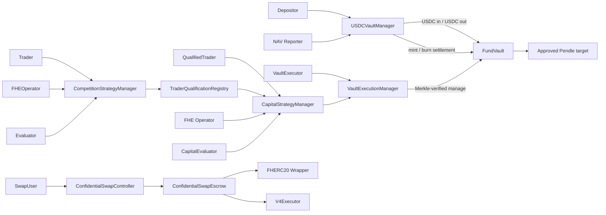
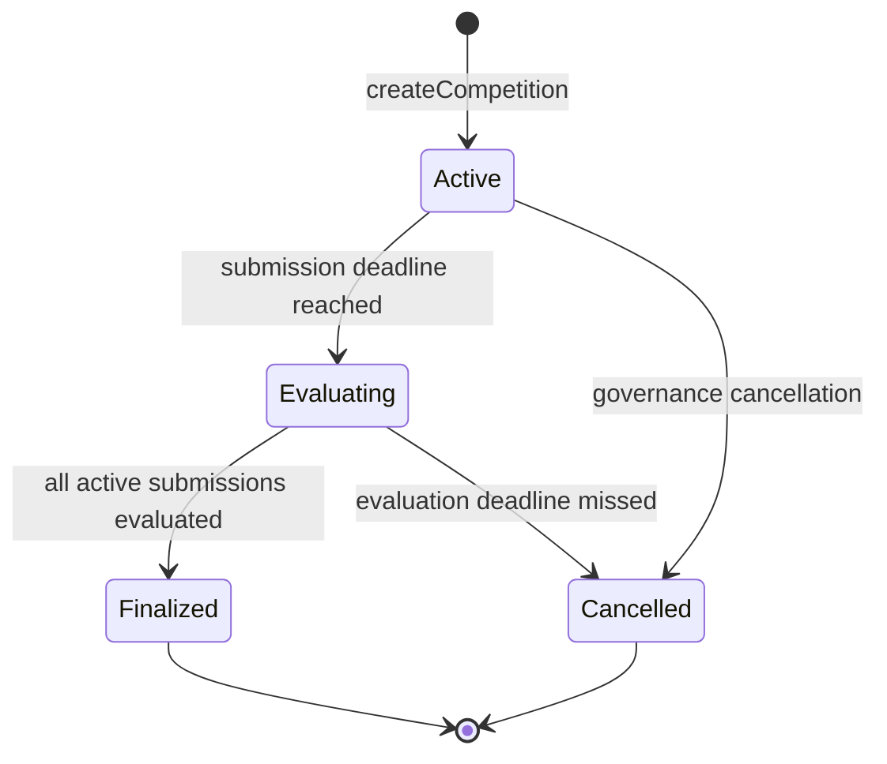

# AlphaEngine Strategy Manager, Confidential Swap, and FundVault Plan

## Fhenix review amendments (2026-09-25)

The owner approved the CoFHE 0.2 / FHERC20 0.4 migration and completing findings
2–4. The [migration contract](cofhe-v020-migration.md) and
[remediation contract](fhenix-decrypt-pressure-remediation.md) supersede older
input, claim and reveal descriptions below and define the approved behavior.
They cover batch proofs, shared handles, unique claim IDs, per-wrapper minimums,
separate swap/withdrawal admission budgets, verified-zero cooldowns, caller-owned
full-balance exits, and once-per-rank score authorization (8 submissions every
5 seconds). Custody ownership, scoring components and qualification are preserved.
Limits are provisional; inherited holder disclosure is outside workflow budgets.

## 1. Summary and deliverable status

The recommended architecture uses independent contracts for competition, capital deployment, confidential swaps, and custody:

- `AlphaEngineCompetitionStrategyManager`
- `AlphaEngineTraderQualificationRegistry`
- `AlphaEngineCapitalStrategyManager`
- `AlphaEngineConfidentialSwapController`
- `AlphaEngineConfidentialSwapEscrow`
- Second pass: `AlphaEngineFundVault`, `AlphaEngineUSDCVaultManager`, and
  `AlphaEngineVaultExecutionManager`

Competition and capital managers share only interfaces and stateless hashing libraries. They do not inherit a storage-bearing `BaseStrategyManager`.

Implementation status as of 2026-08-31: Stages P0 through 15 are implemented
and committed through `90dbdc4`.
Stage 13 adds deterministic Merkle hashing and root generation. Decoder/
sanitizers, root governance, and vault execution are not part of Stage 13.
Stage 15's immutable FundVault execution surface is implemented and committed.
Stage 16's immutable Vault Execution Manager, delayed per-executor policy
roots, exact Capital Manager consumption, dual replay protection, live-code
Merkle verification, approval reset, and per-trader asset-risk enforcement are
implemented and have completed their owner-review checkpoint. Its hardened
stateful model separates entry, holding time, and later exit while independently
reproducing both asset rolling windows. A separately authorized pre-Stage-17
security checkpoint must run X-Ray first and the Solidity Auditor second; it is
not part of the Stage 16 implementation commit. Stage 17 remains the pinned
Pendle execution integration, and Stage 18 remains the final Fizz, audit,
remediation, and release gate.
Stage 7 adds the append-only confidential asset registry, non-custodial
shield/unshield gateway, and fresh upgradeable swap escrow. Stage 8 adds the
fresh bound swap controller, exact execution-data and salted minimum-output
reveal checks, combined controller/escrow invariants, and fresh-path
PoolManager differential parity. Stage 12 USDC FundVault accounting is
implemented and has completed its focused owner-review hardening pass; no
external deployment has occurred.
Stage 9 added fresh paused deployment, independent ProxyAdmin,
versioned manifest, explicit delayed-admin action, selector/topic snapshot,
and listener-cutover tooling. Superseded active legacy Solidity/tests/scripts
were removed while their manifest, ABI, layouts, addresses, and Git history
were preserved.

Stage 10 completed the full local integration/release gate: 173 tests, release
fuzz and invariant profiles, PoolManager differential integration, local
deployment rehearsal, generated ABI/layout/listener parity, runtime sizes,
repository hygiene, and production coverage above 90% for lines and
statements. Evidence is saved in
`docs/releases/stage-10-first-pass-integration-validation.md`.

Stage 11 records `365b3e668217b1f1ca4caede9e6b8fb60526d430` as
the first-pass implementation checkpoint in
`docs/releases/first-pass-implementation-checkpoint.md`. It is a traceability
marker, not a public deployment, external-audit freeze, or production-readiness
claim.

The Stage 5 Competition Manager has also been refined with the owner-approved
post-finalization reveal flow: a dedicated role requests asynchronous public
decryption of all three score components in bounded rank-order batches, and a
readiness-aware getter reads the verified CoFHE results without duplicating
plaintext in manager storage.

Locked decisions:

- Preserve the current v1 encrypted market/component schema and three encrypted evaluation scores.
- Keep all three evaluation scores private during the competition, then allow a
  dedicated score revealer to request asynchronous public decryption in bounded
  rank-order batches after finalization. Do not add a separate aggregate score.
- Use versioned, expiring trader qualification.
- Bind swap execution parameters at submission.
- Launch the first FundVault as a public, USDC-denominated, share-based vault.
- Keep custody and the share ledger in `AlphaEngineFundVault`.
- Use `AlphaEngineUSDCVaultManager` as the only public deposit, asynchronous
  redemption, daily P&L-reporting, share-pricing, vesting, and performance-fee
  surface. It combines only the USDC portions of Teller and Accountant behavior;
  it is not a second custodian.
- Use `AlphaEngineVaultExecutionManager` as the separate Merkle-verified fund
  deployment surface. It cannot mint or burn shares, process deposits or
  withdrawals, or update NAV.
- Accept only USDC in the initial release. Defer multi-asset deposit conversion,
  deposit-asset oracles, the full Veda Teller/Accountant stack, leverage,
  borrowing, flash loans, bridges, and generic routers.
- Calculate daily NAV as USDC-denominated net liquidation value from on-chain
  positions at a declared reference block, after realized costs, expected exit
  costs, protocol costs, and liabilities.
- Mint deposit shares immediately at the current recognized USDC rate. A
  depositor participates in only the remaining unvested gain, whose maximum
  exposure is bounded by the configured vesting period.
- Keep redemption asynchronous: escrow shares on request, calculate assets only
  at completion, and complete only when the FundVault has enough idle USDC.
  Do not create a fixed-value claim or reserve at request time.
- Vest positive reported P&L over a configurable period, initially 24 hours.
  Apply confirmed losses immediately, first against unvested positive P&L and
  then against recognized share value.
- Charge a configurable performance fee, capped at 20%, only on net new profit
  after unrecovered loss. Mint the resulting fee shares after the profit tranche
  finishes vesting; fee-rate changes apply only to future reports.
- Launch fund deployment with Pendle PT actions only.
- Use Safe-controlled roles plus enforced timelocks in production.
- Use fresh proxies and addresses; preserve the legacy deployment and manifest unchanged.

This file is the canonical implementation plan and must be consulted before
each bounded stage. First-pass implementation is already in progress; the
FundVault components remain second-pass design scope until their stage begins.
Every stage stops at its checkpoint for owner review before the next stage.
Documentation changes do not authorize a testnet or production deployment.

## 2. Current-state assessment

Baseline: `49d96e8a80d6903d1d30affc6f836bcc0ac13800`.

### Architectural debt

| Area | Current state | Required correction |
|---|---|---|
| Strategy and swap | One `AlphaEngineIntentController` owns both lifecycles | Separate contracts, storage, nonces, pauses, events, roles, and ABIs |
| Strategy lifecycle | Submission, encrypted scores, and cancellation only | Explicit competition, ranking, qualification, capital approval, rejection, expiry, revocation, and consumption |
| Authority | One `listenerOperator` decrypts, evaluates, and executes swaps | Separate FHE operator, evaluator, qualifier, swap operator, and vault executor authorities |
| Qualification | Not implemented | Trader-level, expiring, versioned, revocable registry |
| Capital authorization | Not implemented | Exact, one-time execution commitment tied to vault, manager, chain, calls, risk envelope, root, nonce, and expiry |
| Swap execution | Operator chooses uncommitted output wrapper, minimum output, calldata, and current executor | Pin executor/output wrapper and commit calldata and salted minimum output during submission |
| Swap vault naming | `AlphaEngineConfidentialVault` is actually a gateway and transient escrow | Replace with explicit asset registry/gateway and `AlphaEngineConfidentialSwapEscrow` |
| Contract size | Current vault runtime is 23,746 bytes, only 830 bytes below EIP-170 | Split registry/gateway behavior from escrow; require at least 1,500 bytes runtime margin |
| Storage | Mixed controller uses slots 0–7 and one shared gap | Fresh proxies; no reinterpretation or migration |
| ABI | Checked-in controller ABI omits current evaluation functions, event, and errors | Archive baseline ABI and add source-generated selector/topic parity gates |
| Deployment | Combined scripts, no vault upgrade test, upgrade script does not enforce manifest chain ID | Independent scripts, wrong-chain rejection, golden deployment tests, versioned manifests |
| CI | No `.github/workflows`; Foundry is an unpinned nightly | Pin a verified stable toolchain and add full CI gates |
| Formatting | `forge fmt --check` currently fails | Isolated non-behavioral cleanup before contract development |
| Veda reference | Local POC is dirty, incomplete, and of uncertain provenance | Architecture reference only; independently design AlphaEngine implementation unless licensed |
| Fund custody and accounting | Earlier plan assumed a shareless treasury vault | Public USDC-only vault with separate custody/share, deposit/NAV, and Merkle-execution authority domains |

The legacy combined proxy and escrow must not be upgraded into any new component. Their addresses, implementation slots, storage layouts, manifest, events, and final indexed block remain historical evidence.

## 3. Final component map

### First pass

| Component | Upgrade model | Purpose |
|---|---|---|
| `AlphaEngineTraderQualificationRegistry` | Fresh transparent proxy | Canonical trader qualification, expiry, versioning, and revocation |
| `AlphaEngineCompetitionStrategyManager` | Fresh transparent proxy | Competition scheduling, encrypted submissions/evaluation scores, plaintext ranking, post-finalization asynchronous public score reveal, and qualification publication |
| `AlphaEngineCapitalStrategyManager` | Fresh transparent proxy | Qualified-trader encrypted intents, independent evaluation, exact approvals, rejection, revocation, expiry, and one-time authorization consumption |
| `AlphaEngineStrategyHashLib` | Stateless library | Competition/capital identifiers and payload hashing |
| `AlphaEngineExecutionHashLib` | Stateless library | Ordered calls, risk envelope, and execution-commitment hashing |
| `AlphaEngineConfidentialAssetRegistry` | Non-upgradeable | Immutable wrapper/underlying registry and wrapper creation |
| `AlphaEngineConfidentialAssetGateway` | Non-upgradeable/stateless | User deposit/shield and ordinary request/claim convenience surface |
| `AlphaEngineConfidentialSwapController` | Fresh transparent proxy | Bound confidential swap submission, execution, refund, nonce, operator, and pause lifecycle |
| `AlphaEngineConfidentialSwapEscrow` | Fresh transparent proxy | FHERC20 lock, unshield, settlement, refund, and custody accounting |
| `AlphaEngineFHERC20ERC20Wrapper` | Existing non-upgradeable pattern | Official shared-handle unshield plus constant-time claim ID lookup |
| `AlphaEngineV4SwapExecutor` | Fresh non-upgradeable deployment | Bounded Uniswap v4 exact-input execution |

### Second pass

| Component | Upgrade model | Purpose |
|---|---|---|
| `AlphaEngineFundVault` | Non-upgradeable | Custody of USDC and deployed positions, ERC20 share ledger, role-gated entry/exit settlement, and execution-manager-only atomic calls |
| `AlphaEngineUSDCVaultManager` | Non-upgradeable | Immediate public USDC deposits, asynchronous redemptions, daily P&L reports, share pricing, configurable positive-P&L vesting, immediate loss recognition, and bounded performance fees |
| `AlphaEngineVaultExecutionManager` | Non-upgradeable | Capital authorization, Merkle proofs, root governance, replay protection, risk envelopes, and vault orchestration |
| `IAlphaEngineDecoderAndSanitizer` | Interface | Fail-closed protocol calldata inspection |
| `AlphaEngineERC20DecoderAndSanitizer` | Non-upgradeable | Finite approvals/reset and spender policy extraction |
| `AlphaEngineERC4626DecoderAndSanitizer` | Non-upgradeable | Standard ERC4626 entry/exit with FundVault-only receiver and owner |
| `AlphaEnginePendleV4PtDecoderAndSanitizer` | Non-upgradeable | Narrow current-RouterV4 token-to-PT and PT-to-token validation plus facet pinning |
| `GenerateAlphaEngineManageRoot` | Foundry script | Deterministic leaf, tree, proof, and human-readable policy artifact generation |



## 4. Responsibilities and prohibited responsibilities

| Contract | Owns | Must never own |
|---|---|---|
| Qualification Registry | Trader validity, version, expiry, evidence source, revocation | Encrypted strategies, rankings, approvals, custody, protocol calls |
| Competition Manager | Competition config, encrypted submissions, encrypted scores, ranks, qualification eligibility | Capital approvals, vault access, swap state, token custody |
| Capital Manager | Encrypted capital intents, evaluations, immutable execution commitments, consumption state | Competition ranking, Merkle roots, arbitrary calls, token custody |
| Asset Registry | Wrapper registration and immutable wrapper/underlying association | User balances, swap locks, execution |
| Asset Gateway | Stateless shield/unshield convenience | Persistent custody, wrapper mutation, strategy state |
| Swap Controller | Swap records, bound route commitments, execution/refund status | Strategy state, pooled capital, protocol-specific imports |
| Swap Escrow | Temporary confidential custody, lock/unshield/settle/refund accounting | Competition/capital state, pooled LP funds, route selection |
| V4 Executor | Exact-input V4 mechanics | Strategy evaluation, custody bookkeeping, arbitrary callers |
| FundVault | USDC and position custody, ERC20 share ledger, USDC-manager-only entry/exit settlement, execution-manager-only atomic batches | FHE, qualification, evaluation, NAV calculation, public request handling, Merkle-root governance |
| USDC Vault Manager | Immediate public USDC deposits, asynchronous redemption requests/completion, P&L reports, share-price accounting, gain vesting, loss recovery, and performance-fee calculation | Long-lived custody, strategy evaluation, Merkle roots, arbitrary protocol calls, multi-asset conversion |
| Vault Execution Manager | Root policy, exact capital authorization, decoder/proof checks, risk limits, replay, and vault orchestration | Strategy evaluation, trader qualification, share mint/burn, deposits, withdrawals, NAV updates, long-lived custody |
| Decoders | Fail-closed calldata inspection | Mutable state, token custody, arbitrary external actions |
| Root generator | Reproducible policy artifacts | On-chain authority or production secrets |

No owner, trader, evaluator, NAV reporter, executor EOA, or root administrator
receives a direct arbitrary-call role on `AlphaEngineFundVault`. The USDC
manager receives only entry/exit selectors; the execution manager receives only
the bounded atomic-call selector. Those authorities are not interchangeable.

## 5. State machines

### Competition



Submission lifecycle:

```text
Unset → Submitted → Cancelled
                  → Evaluated
```

Rules:

- Maximum 256 active submissions per competition.
- One active submission per trader per competition; cancellation permits a fresh resubmission with a new nonce.
- Maximum 16 encrypted strategy components.
- Evaluation is terminal and can occur once.
- Ranks are plaintext, nonzero, unique, and bounded by active submission count.
- Finalization requires `evaluatedCount == activeSubmissionCount`.
- Eligibility is deterministic: `rank <= qualificationSlots`.
- Qualification is published only after competition finalization.
- No qualification is attached to a strategy; publication grants the trader a registry record.

Qualification lifecycle:

```text
Unqualified → Qualified(version=1, validUntil)
Qualified → Extended(same version, later validUntil)
Qualified → Revoked(version++)
Expired/Revoked → Qualified(version++, new validUntil)
```

Capital intents store the active qualification version. A revoked or expired version can never be revived by later requalification.

### Capital

```text
Unset → PendingEvaluation → Cancelled
                          → Rejected
                          → Approved → Consumed
                                     → Revoked
                                     → Expired
```

Rules:

- Submission, approval, and consumption each recheck qualification validity and exact version.
- Changing any execution field requires revocation and a fresh encrypted capital intent.
- Trader cancellation remains available while paused.
- Evaluator/governance revocation remains available while paused.
- `expireCapitalIntent` is permissionless after the applicable deadline.
- Downstream vault failure atomically rolls back consumption.

### Confidential swap

```text
Unset → Active → Executed
               → Refunded
```

Escrow lifecycle:

```text
Unset → Locked → UnshieldRequested → Consumed
                                  → Refunded
```

Rules:

- Locking immediately requests encrypted unshield; no user-cancel state is introduced.
- An insufficient-balance confidential transfer may create an initialized
  encrypted-zero lock. A verified zero result cannot execute a swap, but the
  refund path must claim and terminate it without attempting a zero-value
  re-shield.
- Because wrapper claims are permissionless and pay a fixed recipient, an
  already-claimed input is reconciled from escrow custody after verifying the
  exact claim handle, recipient, decrypted amount, and available underlying.
- Execution is operator-only and must occur before expiry.
- Refund is permissionless after expiry or while controller/escrow is paused.
- Refund and output always return to the recorded original trader.
- The dead legacy `Unlocked` state is removed.
- Existing canonical FHERC20 returned-handle behavior is preserved.

### USDC deposits and withdrawals

Deposit lifecycle:

```text
User USDC + current recognized rate → atomic USDC transfer + share mint
```

Redemption lifecycle:

```text
Unset → Pending → Completed
                → Cancelled
```

Rules:

- Deposits are USDC-only and mint immediately at the current recognized share
  rate. USDC moves directly from the payer to the FundVault; the manager never
  retains it.
- Deposits during an active profit vest do not receive the already-recognized
  portion. They participate pro rata in the remaining locked portion. Linear
  vesting bounds the historical-gain exposure; the initial vesting period is 24
  hours.
- Deposit shares round down. A zero-share result or caller-provided minimum-share
  violation reverts the entire transfer and accounting update.
- Redemption requests escrow shares but do not fix an asset amount. The shares
  continue participating in gains and losses until completion.
- Completion uses the then-current recognized rate, burns the escrowed shares,
  and transfers USDC atomically. If idle USDC is insufficient, the request stays
  pending until approved strategy unwinds return enough USDC.
- The requester may cancel a pending redemption and recover the exact escrowed
  shares. Completion is permissionless and respects the request's minimum-asset
  bound.
- A zero-valued redemption with `minAssets == 0` may burn shares after a total
  loss so that the request retains a terminal path. A nonzero minimum prevents
  that completion.
- The USDC manager cannot retain USDC beyond an atomic call boundary.
- Deposit/withdrawal operations have a pause domain independent from strategy
  execution; emergency policy must still permit safe user exits.

### Daily NAV and yield recognition

```text
Unreported → Reported → PositiveGainVesting → FullyRecognized
                      → LossRecognizedImmediately
```

Rules:

- Each report binds a sequential epoch, strictly increasing finalized reference
  block, signed profit-or-loss amount, and nonzero reproducibility hash.
- Positive P&L vests linearly over the configured period and is not immediately
  redeemable.
- A confirmed loss first cancels unvested positive P&L, then reduces recognized
  share value immediately.
- Only one positive tranche may vest at a time. A later positive report waits
  until it finishes; a loss can be reported during vesting and takes effect
  immediately.
- Losses below the prior high-water level accumulate as `lossToRecover`; later
  recovery profit is not charged a performance fee twice.
- A report settles any fully vested prior tranche before applying the next P&L.
- Non-sequential epochs, non-monotonic/future reference blocks, zero report
  hashes, zero amounts, and losses above managed assets revert.
- NAV reporting never transfers assets and never authorizes execution.

## 6. Public interfaces, identifiers, and hashes

All hashes use `abi.encode`, never packed encoding of dynamic values. Fixed-vector tests must independently compute every value in Solidity and one off-chain implementation.

### Identifiers

```solidity
COMPETITION_ID_V1_TYPEHASH =
    keccak256(
        "AlphaEngineCompetitionIdV1(uint256 chainId,address manager,uint64 competitionNonce,bytes32 rulesHash)"
    );

COMPETITION_SUBMISSION_ID_V1_TYPEHASH =
    keccak256(
        "AlphaEngineCompetitionSubmissionIdV1(uint256 chainId,address manager,bytes32 competitionId,address trader,uint64 traderNonce)"
    );

CAPITAL_INTENT_ID_V1_TYPEHASH =
    keccak256(
        "AlphaEngineCapitalIntentIdV1(uint256 chainId,address manager,address trader,uint64 traderNonce)"
    );

SWAP_INTENT_ID_V1_TYPEHASH =
    keccak256(
        "AlphaEngineSwapIntentIdV1(uint256 chainId,address controller,address trader,uint64 traderNonce)"
    );
```

Each family has its own nonce mapping. A nonce increases exactly once if and only if submission succeeds.

### Strategy payloads

```text
componentsHash = keccak256(abi.encode(componentHandles))
```

Competition payload binds:

- chain ID;
- manager;
- competition submission ID;
- competition ID;
- trader;
- trader nonce;
- encrypted market handle;
- timeframe key;
- competition evaluation deadline;
- ordered component-handles hash.

Capital payload binds the equivalent fields plus the qualification version and capital-intent deadline.

`createdAt`, transaction hash, log index, and current operator are excluded from replay-critical hashes. The operator snapshot is stored separately for auditability.

### Call and risk hashes

```solidity
callHash[i] = keccak256(
    abi.encode(
        CALL_V1_TYPEHASH,
        i,
        decoder[i],
        target[i],
        value[i],
        keccak256(targetData[i])
    )
);

callsHash = keccak256(
    abi.encode(
        CALLS_V1_TYPEHASH,
        callCount,
        keccak256(abi.encode(callHashes))
    )
);
```

Risk limits are sorted by ascending asset address and may not contain duplicates:

```solidity
assetLimitHash[i] = keccak256(
    abi.encode(
        ASSET_DELTA_LIMIT_V1_TYPEHASH,
        i,
        asset,
        maxSpend,
        minReceive
    )
);

riskEnvelopeHash = keccak256(
    abi.encode(
        RISK_ENVELOPE_V1_TYPEHASH,
        limitCount,
        keccak256(abi.encode(assetLimitHashes)),
        uint256(0) // initial release permits no native value
    )
);
```

### USDC NAV and share-accounting specification

The initial vault has one accounting unit and one accepted deposit asset: USDC.
The off-chain calculator derives a net change from public on-chain positions:

```text
currentNetNav =
    idleActiveUSDC
  + sum(netLiquidationValueUSDC(position[i]))
  + claimableRewardsUSDC
  - accruedLiabilitiesUSDC

periodPnL =
    currentNetNav
  - previousNetNav
  - depositsSincePreviousReport
  + completedRedemptionsSincePreviousReport
```

`netLiquidationValueUSDC` means the amount reasonably recoverable in USDC at
the declared reference block after realized execution costs, current expected
exit costs, slippage under the versioned methodology, protocol costs, and any
vault-borne liabilities. Idle USDC is part of NAV, whether newly deposited or
awaiting deployment. Gas is included only when the FundVault pays or reimburses
it. The on-chain manager receives the already flow-neutralized positive or
negative `periodPnL`; it does not recalculate position values.

Accounting rules:

- The NAV calculator runs off-chain from public on-chain state. The on-chain
  NAV reporter submits only the aggregate result and reproducibility metadata;
  it cannot move funds or approve calls.
- The report transaction and role authorization are sufficient for the initial
  release; a separate signed reproducibility report is not required. A public
  transparency artifact should reproduce positions, valuation inputs, costs,
  and the aggregate result.
- `referenceBlock` must be finalized and strictly newer than the prior report.
  The report hash commits the off-chain reproducibility artifact and methodology.
- Shares use 18 decimals while USDC uses 6. The first deposit mints
  `assets * 1e12` shares. There are no virtual assets, queued checkpoints, or
  hidden accounting balances.
- Define `remainingLockedProfit` as the linearly unvested part of the current
  positive tranche and `availableAssets = managedAssets - remainingLockedProfit`.
  Round the remaining amount up so a nonzero tranche cannot become fully
  redeemable or fee-settle before the exact unlock timestamp.
- For nonzero supply, deposits mint
  `floor(assets * totalSupply / availableAssets)`. Deposits round down and must
  not reduce the pre-deposit recognized share price; their cross-product
  rounding residue is strictly less than one USDC base unit of value.
- Redemptions complete for
  `floor(shares * availableAssets / effectiveSupply)`, where `effectiveSupply`
  includes any fee shares that a fully vested but not yet settled tranche would
  mint. Redemptions round down and must not reduce the value of remaining shares.
- Direct USDC donations do not alter `managedAssets`, mint shares, or change the
  conversion rate. They remain observable physical liquidity until explicitly
  reconciled by a separately authorized operation.
- Positive `periodPnL` enters one configurable linear vest, initially 24 hours.
  It increases managed NAV immediately but becomes redeemable only as it vests.
- Negative `periodPnL` reduces unvested positive P&L first and then recognized
  NAV immediately. A loss can never be deferred behind the vesting schedule.
- Performance-fee entitlement vests with the feeable profit. A loss reduces the
  fee associated with cancelled unvested feeable profit using conservative
  upward rounding, but does not claw back entitlement on profit already vested.
  If the loss consumes the final locked unit, any surviving vested fee is
  crystallized in that same transaction rather than silently waived.
- Losses that reduce previously recognized NAV increase `lossToRecover`.
  Subsequent profit first restores that amount and is not feeable.
- A completed redemption scales `lossToRecover` by the remaining share-supply
  fraction, rounding the remaining deficit up. Deposits do not increase the
  aggregate pre-existing deficit. This is a fund-level high-water mechanism,
  not per-investor fee equalization.
- For the remaining net-new profit, snapshot the current fee rate and compute
  `feeAssets = floor(feeableProfit * performanceFeeBps / 10_000)`. The fee is
  capped at 20% and governance updates are prospective.
- After the tranche fully vests, compute
  `feeShares = floor(feeAssets * totalSupply / (managedAssets - feeAssets))`.
  Mint those shares to the configured fee recipient. Their redemption value
  must never exceed `feeAssets`; rounding benefits existing shareholders.
  Preview pricing includes the virtual matured fee before minting, so fee
  crystallization itself cannot change deposit or redemption pricing.
- PT redemption is a change in asset composition. Only the difference between
  redemption proceeds and the position's previously reported net value is new
  P&L. Redeployment fees and slippage appear in the next post-transaction NAV.
- The initial release does not use a Chainlink feed for deposits because both
  deposit asset and accounting unit are USDC. Any future USDT, ETH, or BTC
  deposit adapter is a separately planned module that converts to actual USDC
  before minting and may use independent oracle bounds.
- There is no deposit, redemption, or AUM fee in the initial release.

The on-chain manager stores only the compact state required to enforce these
equations: managed assets, one locked-profit tranche and its recovery/fee split,
unrecovered loss, report ordering, fee configuration, vesting timestamps, and
redemption records. External-flow counters belong in the reproducibility
artifact; deposits and completed redemptions already emit exact on-chain deltas.

### Execution commitment

```solidity
executionCommitment = keccak256(
    abi.encode(
        EXECUTION_COMMITMENT_V1_TYPEHASH,
        block.chainid,
        address(capitalStrategyManager),
        address(vaultExecutionManager),
        address(fundVault),
        intentId,
        trader,
        qualificationVersion,
        executor,
        authorizationNonce,
        validAfter,
        deadline,
        policyRoot,
        policyVersion,
        callsHash,
        riskEnvelopeHash,
        riskPolicyVersion,
        submissionPayloadHash,
        evaluationEvidenceHash
    )
);
```

Mandatory properties:

- `validAfter < deadline <= capitalIntent.deadline`.
- Maximum authorization window: one hour.
- `authorizationNonce` is globally unique within the capital manager.
- The current root, root version, risk-policy version, qualification version, manager, vault, executor, chain, and commitment must match at consumption.
- The commitment and authorization nonce are marked consumed before external execution.
- Proofs are not hashed; the root and exact leaf inputs are.
- Cross-chain execution is out of scope. A later LayerZero pathway requires a separate destination verifier binding source chain, source sender, message nonce, destination manager, and destination replay state.

### Swap binding

At submission, the user provides:

- input and output wrappers;
- opaque `routeKey`;
- `keccak256(executionData)`;
- a salted minimum-output commitment;
- encrypted input;
- deadline.

```solidity
minimumOutputCommitment = keccak256(
    abi.encode(
        SWAP_MIN_OUTPUT_V1_TYPEHASH,
        intentId,
        minimumOutput,
        salt
    )
);
```

The record pins the current escrow and executor. Execution reveals `executionData`,
`minimumOutput`, and `salt`; any mismatch reverts. Client tooling must generate a
cryptographically random 32-byte salt. The committed minimum applies to total measured
underlying output before confidential precision conversion. If the output wrapper rate exceeds
one, settlement shields the largest exact rate multiple and returns the remainder directly to
the original trader, so `total output == shielded units * rate + returned dust` and the escrow
retains no remainder.

## 7. FHE internalization and permissions

For competition and capital submissions:

1. Internalize `[market, ...components]` external uint128 handles with one `FHE.asEuint128s` batch proof bound to this manager.
2. Reject zero/uninitialized resulting handles.
3. Call `FHE.allowThis` for every handle.
4. Grant access to the manager’s `fheOperator` snapshot.
5. Store and emit only canonical `bytes32` handles.
6. Store `operatorAtSubmission`.
7. Internalize the three evaluator-provided external uint32 scores with one `FHE.asEuint32s` batch proof.
8. Grant score-handle access to the contract and submitting trader.
9. Assert permissions directly against the Fhenix task manager in tests.

Operator rotation affects only future submissions. Existing access cannot be cryptographically revoked. If an operator is compromised:

- pause new submissions immediately;
- cancel or invalidate pending submissions;
- rotate the configured operator through governance;
- require fresh encrypted resubmission;
- disclose that already-authorized ciphertext may already have been decrypted.

The local CoFHE mock validates repository logic but does not prove production cryptography. A production Fhenix-network permission/decryption test remains a release gate.

## 8. Roles and authority

Production defaults:

- 48-hour delay for upgrades, nonzero root activation, role/config expansion, and unpause.
- Immediate pause and zero-root revocation.
- Each proxy has an independent `ProxyAdmin`.
- Testnet role collapse is allowed only when explicitly marked `testOnlyRoleCollapse: true` in the manifest.

| Authority | Recommended holder | Allowed | Prohibited |
|---|---|---|---|
| Owner/default admin | Protocol Timelock controlled by Governance Safe | Role/config administration | Daily evaluation or execution |
| Upgrader | Per-proxy `ProxyAdmin`, owned by Upgrade Timelock | Upgrade one named proxy | Evaluation, pause, execution |
| Pauser | Emergency Safe | Immediate pause | Unpause, root installation, upgrade |
| FHE operator | Dedicated service/TEE key per manager | Decrypt newly submitted handles | Evaluate, qualify, approve, custody |
| Competition evaluator | Dedicated service or evaluator Safe | Record scores, evidence, and ranks | Publish arbitrary qualification or access capital |
| Score revealer | Dedicated keeper/service | Request asynchronous public decryption of finalized score handles in bounded rank-order batches | Change scores, ranks, evidence, or reveal before finalization |
| Qualifier/finalizer | Qualification Safe | Finalize complete competitions | Alter ranks or capital approvals |
| Qualification issuer | Competition manager contract | Publish eligible traders to registry | Direct EOA qualification |
| Qualification revoker | Emergency Safe/governance | Revoke compromised traders | Approve capital |
| Capital evaluator | Capital approval Safe/service | Reject or approve exact commitments | Execute vault calls or set roots |
| Swap operator | Swap-only service key | Execute committed swaps | Change execution commitment or administer strategy |
| Trader | User | Submit/cancel own eligible intent | Direct vault access |
| Root proposer | Root Safe | Propose root plus artifact hash | Immediate activation |
| Root activator | Anyone after delay | Activate exact pending root | Modify proposal |
| Root guardian | Emergency Safe | Set active root to zero and pause | Install nonzero root |
| Vault executor | Automation service | Submit exact approved bundle and proofs | Approve intent, set root, bypass manager |
| NAV reporter | Dedicated reporting service/Safe | Submit bounded NAV reports for finalized blocks | Move assets, execute strategies, set roots, mint shares directly |
| USDC settlement operator | Deposits are user-called; redemption completion is permissionless once liquidity/minimum conditions hold | Complete the exact pending redemption | Choose P&L, alter recipients, execute protocol calls |
| FundVault accounting manager | `AlphaEngineUSDCVaultManager` | Invoke only entry/exit settlement selectors | Invoke `manage`, set roots, evaluate strategies |
| FundVault execution manager | `AlphaEngineVaultExecutionManager` | Invoke only the atomic `executeBatch` selector | Mint/burn shares, process deposits/withdrawals, report NAV |
| Recovery authority | Emergency Safe | Pause and migrate supported assets only to a precommitted replacement custody vault that preserves shareholder claims | Send assets to treasury or choose an arbitrary recipient |

The same production signer must not simultaneously control admin, evaluator, root, and execution authority.

## 9. Threat model

| Threat | Mandatory controls | Residual risk |
|---|---|---|
| Compromised owner/admin | Timelock, separate roles, initial paused state, event monitoring | Governance ultimately controls configuration |
| Compromised upgrader | Separate ProxyAdmins, Safe+delay, golden layout and code-hash checks | Authorized upgrade can replace logic |
| Compromised pauser | Pauser cannot unpause or move funds | Denial of service |
| Compromised FHE operator | No evaluation/custody role, short intent windows, emergency pause/resubmission | Previously granted ciphertext access cannot be revoked |
| Compromised evaluator | Separate execution/root roles, exact evidence and finite authorization | Off-chain evaluation remains trusted |
| Malicious trader | Qualification gating, bounds, proof validation, exact commitments, no vault role | Gas/state spam paid by trader |
| Compromised root administrator | Delayed nonzero root, artifact review, immediate zero-only emergency action | Timelocked governance can eventually broaden policy |
| Compromised vault executor | Exact commitment, root proof, risk envelope, one-time consume | Executor can choose transaction timing within validity window |
| Compromised NAV reporter | Finalized-block binding, strict monotonicity, methodology hash, report bounds, 24-hour positive vest, immediate pause | A bounded false loss can reduce recognized value before governance reacts |
| Stale or incorrect NAV | Maximum report age, reproducible transparency artifact, independent monitoring, pause/outlier bounds | Off-chain position valuation remains a trusted input |
| Deposit timing arbitrage | Immediate pricing excludes remaining locked profit; positive gains vest linearly before becoming redeemable | A new depositor can receive a bounded pro-rata share of the remaining vest, accepted as the simplicity tradeoff |
| Donation/share inflation | Conversion uses manager-accounted assets rather than raw token balance; direct transfers mint no shares; zero-share deposits revert | Unreconciled token donations may create operational accounting work |
| Withdrawal liquidity shortfall | Shares remain escrowed and floating until completion; minimum-assets bound; approved unwind returns USDC before atomic burn/payment | Strategy unwind can delay settlement or realize loss |
| Listener/indexer failure | ABI/topic snapshots, getter/event parity, reorg-safe dedupe and replay | Off-chain availability remains operational |
| Cross-contract reentrancy | Verify first, effects before interactions, non-reentrant manager, atomic rollback | External protocols remain untrusted |
| Replay | Chain/contract domains, qualification version, authorization nonce, root version, deadline, dual consumed mappings | Finality/reorg handling is operational |
| Front-running | Role-gated execution, hidden commitment until reveal, private transaction delivery | Public-chain ordering cannot be eliminated |
| Stale approval | Root/risk/qualification versions and short deadline | External protocol state may change before execution |
| Malicious calldata | Exact calldata hash plus decoder/sanitizer proof | Decoder correctness is security-critical |
| Malicious decoder | Non-upgradeable code, code-hash-bound leaves, exhaustive mutation tests | A reviewed decoder may still contain a defect |
| Storage corruption | Fresh proxies, disabled implementation initializers, storage gaps, golden layouts | Upgrade authority remains trusted |
| Dependency compromise | Exact SHAs, clean submodules, license/provenance checks, production integration tests | Fhenix/protocol governance remains external |
| Upgradeable target changes | Target/proxy implementation monitoring and root revocation | Proxy code can change without AlphaEngine action |
| Bad swap route | User-bound executor/output/data/minimum | User may deliberately submit an uneconomic route |
| Encrypted-zero lock | Verified zero cleanup through the refund lifecycle; zero cannot reach the executor | Submission still creates a transient record before decryption completes |
| Permissionless wrapper preclaim | Fixed escrow recipient, exact claim-state reconciliation, balance sufficiency checks, adversarial-order tests | Preclaimed underlying remains temporarily visible in escrow until terminal processing |
| Emergency-role compromise | Can pause or move assets only to a precommitted replacement vault while preserving share claims | Emergency migration governance remains trusted |

## 10. Security invariants

### Qualification Registry

- A grant never shortens an active qualification.
- Extension preserves the version.
- Revocation invalidates the current version.
- Requalification after expiry/revocation creates a strictly newer version.
- Only an authorized competition manager issues qualification.
- Revocation remains available while paused.

### Competition Manager

- Nonce exactness and identifier uniqueness.
- One active submission per trader per competition.
- Component count equals stored handle count and stays in `[1,16]`.
- Stored handles retain manager and operator permissions.
- Evaluation is one-shot and terminal.
- Rank is unique and bounded.
- Finalization is impossible until every active submission is evaluated.
- Qualification publication is impossible before finalization or above the qualification cutoff.
- Score-decryption requests are impossible before finalization, process all
  three score components together, and are bounded to eight submissions per call, once per rank and paced across competitions.
- No token or arbitrary-call surface exists.

### Capital Manager

- Submission requires an active qualification.
- Approval and consumption require the exact stored qualification version.
- Each intent has at most one evaluation decision and one immutable approval.
- Authorization deadline does not exceed intent deadline.
- Any changed commitment field produces a different hash and reverts.
- Only the exact approved execution manager consumes.
- Consumption occurs once.
- Failed downstream execution rolls back consumption.
- The contract holds no ERC20/FHERC20 balances and cannot call arbitrary targets.

### Confidential swap

- Swap nonce equals successful swap submissions only.
- Record pins escrow, executor, wrappers, route hash, minimum commitment, and deadline.
- Operator cannot substitute any committed execution field.
- Escrow and controller statuses remain in parity.
- Actual FHERC20 returned handles are canonical.
- Initialized encrypted-zero locks retain a verified terminal refund path and
  never reach swap execution.
- Permissionless preclaims cannot strand a live lock or cause a second claim;
  escrow-held preclaimed underlying equals the sum attributable to live
  preclaimed locks.
- `liveSwapLockCount` equals all live unshield-requested locks.
- Wrapper mappings are bijective and immutable.
- Controller/registry rotation is blocked while relevant locks exist.
- Settlement/refund is atomic.
- Minimum output is enforced against total output before the wrapper-rate split.
- Higher-decimal output equals shielded units times wrapper rate plus exact dust
  returned directly to the original trader.
- Escrow and executor retain zero residual underlying.
- Output/refund recipient is always the original trader.

### FundVault custody and shares

- FundVault is the only long-lived custodian of active USDC and deployed
  positions; neither manager retains assets outside an atomic call boundary.
- Only the locked USDC manager invokes entry/exit settlement selectors.
- Only the locked execution manager invokes the atomic `manage` selector.
- Neither manager can use the other manager's selectors.
- Share minting occurs only against an exact measured USDC deposit; raw token
  transfers never mint shares.
- Share burning and USDC payment occur atomically only at redemption completion.
  A pending request creates no fixed-value reserve, so idle USDC remains
  deployable until a completion transaction succeeds.
- Total share supply equals the sum of balances and escrowed withdrawal shares.
- The first depositor receives `assets * 1e12` shares; later mint/redeem
  conversions use manager-accounted assets and deterministic floor rounding.
  Direct donations cannot manipulate the rate and zero-share deposits revert.
- Any emergency migration preserves every shareholder's pro-rata claim and can
  target only the precommitted replacement vault.

### USDC Vault Manager accounting

- Only USDC is accepted and all accounting uses its exact token decimals.
- A reference block and methodology version/hash are monotonic and immutable
  once reported.
- The off-chain report artifact flow-neutralizes deposits and completed
  redemptions using their exact events; the on-chain report commits a sequential
  signed P&L delta and reproducibility hash.
- A positive report cannot become fully redeemable before its configured vest
  ends.
- A loss is recognized immediately, consumes unvested gain first, and cannot
  increase any user's redeemable amount.
- A deposit cannot receive already-recognized historical P&L; it can participate
  only in the remaining locked gain.
- A pending redemption has no fixed asset claim. Pricing, share burning, and
  payment are atomic at completion and fail without mutation if liquidity or
  the minimum-asset condition is not met.
- Rounding always favors the vault: both deposit shares and redemption assets
  round down.
- A total-loss redemption with zero minimum assets retains a terminal burn path.
- Performance-fee shares represent no more than the configured fee on net-new
  profit after unrecovered losses, and fee-rate changes are prospective.
- NAV reporting cannot transfer assets, mint/burn shares directly, or call a
  strategy target.
- The manager's residual USDC balance is zero after every successful operation.

### Vault execution and Merkle boundary

- Only the locked execution manager invokes the vault batch.
- Owner, trader, NAV reporter, root admin, and executor have no direct arbitrary-call path.
- Batch is nonempty, capped at 16, and all arrays have equal lengths.
- All proofs, decoder checks, code hashes, commitment fields, and risk checks
  pass before the first value-bearing call.
- Root change invalidates commitments bound to the prior version.
- Emergency guardian can only pause or activate the zero root.
- Initial release permits zero native value and no `delegatecall`.
- Exact approvals are reset to zero in the same bundle.
- Per-asset spend does not exceed the committed or rolling cap. Redemptions wait
  for idle USDC rather than blocking deployment with a pre-priced reserve.
- Per-asset receipt is at least the committed minimum.
- Failed execution restores local and capital-manager replay state atomically.

## 11. First-pass implementation scope

Included:

- Qualification Registry.
- Competition and Capital Strategy Managers.
- Current v1 encrypted submission and score types.
- Independent FHE operators, evaluators, nonces, pause domains, ABIs, and events.
- Exact execution-commitment interfaces and mock-consumer integration tests.
- Confidential swap extraction and route binding.
- Wrapper registry/gateway extraction to restore bytecode margin.
- Fresh deployment scripts, manifests, ABIs, layouts, listeners, and tests.

Excluded:

- Real pooled FundVault, USDC manager, and vault execution deployment; these are
  the separately bounded second pass.
- Merkle root verification in production.
- Public shares, daily NAV accounting, and asynchronous redemptions until the
  second pass. The full multi-asset Veda Teller/Accountant stack and deposit,
  redemption, or AUM fees remain out of scope; the second pass includes only
  the bounded performance fee defined in section 6.
- Cross-chain execution.
- Generic UEI or arbitrary encrypted schema.
- Leverage, borrowing, flash loans, bridges, batching beyond exact vault call bundles.
- Legacy proxy storage migration.

The capital manager may deploy before the real execution manager, but production approval remains disabled until governance allowlists the audited second-pass manager.

## 12. Second-pass FundVault/Veda architecture

Use the local [Veda POC](/Users/nilay/yieldfi/veda-poc/src/StrategyWithMerkleVerification.sol:24) only as an architectural reference.

Current official Veda main was inspected at [`39f9d3144fd0416fdcb467ecec916b31457c915d`](https://github.com/Veda-Labs/boring-vault/commit/39f9d3144fd0416fdcb467ecec916b31457c915d). Its current core files are `SEL-1.0`, marked test-only/no-commercial-use. Production copying or derivative use therefore requires a written commercial license; otherwise AlphaEngine must independently implement the concepts after legal/provenance review. [Official license](https://github.com/Veda-Labs/boring-vault/blob/39f9d3144fd0416fdcb467ecec916b31457c915d/LICENSE.md).

### Custody, deposits, and accounting model

`AlphaEngineFundVault` is the BoringVault-like core:

- It is the sole custodian of active USDC, PTs, rewards, and other explicitly
  supported position assets.
- It is the ERC20 share token and exposes minimal role-gated entry/exit
  settlement primitives plus a separate atomic `manage` primitive.
- `AlphaEngineUSDCVaultManager` is permanently limited to entry/exit settlement.
- `AlphaEngineVaultExecutionManager` is permanently limited to `manage`.
- It does not calculate NAV, accept public requests, evaluate encrypted intents,
  set Merkle roots, or qualify traders.

`AlphaEngineUSDCVaultManager` is the only initial public fund surface:

- Accept USDC only and denominate all shares, NAV, P&L, deposits, and
  withdrawals in USDC.
- Mint shares immediately against the exact measured USDC received by the
  FundVault at the current recognized rate.
- Escrow shares for asynchronous redemption. If needed, wait for an approved
  unwind; then price, burn, and pay USDC atomically at completion.
- Accept an authorized daily signed P&L report for a finalized block and apply
  the formulas, rounding, vesting, loss-recovery, and performance-fee rules in
  section 6.
- Keep calculator and reporter conceptually separate: calculation is an
  off-chain deterministic service over public on-chain state; reporting is the
  narrow on-chain role that commits the result and metadata.
- Emit sufficient inputs for a public transparency page. The transparency page
  is an observability control, not a contract authorization boundary.
- Retain no USDC after an operation. Funds ultimately enter and leave the
  FundVault, not the execution manager.

This manager intentionally combines only the one-asset deposit/withdrawal
surface and accounting-rate responsibilities that Veda separates across Teller
and Accountant. The initial release does not deploy the general Veda
[Teller](https://docs.veda.tech/architecture-and-flow-of-funds/teller) or
[Accountant](https://docs.veda.tech/architecture-and-flow-of-funds/accountant),
and it needs no deposit conversion oracle because USDC is both the accepted
asset and accounting unit.

Treasury capital, if any, enters through the same USDC manager and receives
shares under the same immediate-mint rules. Unaccounted direct donations must
not grant shares or alter the manager-accounted conversion rate.

Emergency asset migration is available only while paused, only to a
precommitted replacement FundVault, and only through a procedure that preserves
shareholder claims. It is not a treasury withdrawal mechanism.

### Merkle policy

A Veda-style action root constrains action classes; it does not authorize a specific AlphaEngine intent.

```solidity
leaf = keccak256(
    abi.encode(
        MANAGE_LEAF_V1_TYPEHASH,
        block.chainid,
        address(vaultExecutionManager),
        address(fundVault),
        decoder,
        decoder.codehash,
        target,
        target.codehash,
        selector,
        maxNativeValue,
        keccak256(sanitizedArguments)
    )
);
```

The exact V1 type string is:

```text
AlphaEngineManageLeafV1(uint256 chainId,address vaultExecutionManager,address fundVault,address decoder,bytes32 decoderCodeHash,address target,bytes32 targetCodeHash,bytes4 selector,uint256 maxNativeValue,bytes32 sanitizedArgumentsHash)
```

Initial `maxNativeValue` is always zero.

For each executor:

- `ROOT_PROPOSER_ROLE` proposes root, artifact hash, and activation time.
- Activation requires at least 48 hours.
- Anyone may activate the exact pending proposal after delay.
- Governance/guardian may cancel a pending proposal.
- Emergency guardian may immediately set the active root to zero.
- Root version increments on every activation or emergency revocation.
- Existing approvals bound to an older root/version become stale.

### Root generator

The Foundry generator must:

- reuse the production hashing library;
- sort and deduplicate leaves;
- reject duplicate definitions;
- use sorted pair hashing;
- carry an unpaired node unchanged to the next level;
- prove deterministic behavior for 1, 2, 3, 5, and 16 leaves;
- emit chain, vault, manager, executor, root/version, decoder/target code hashes, human-readable leaves, tree, and proofs;
- reproduce the artifact byte-for-byte in CI.

Stage 13 implements only this stateless hash/tree/artifact boundary. It caps a
generated policy at 256 leaves, sorts definitions by leaf hash, rejects
duplicate leaf hashes and malformed metadata, and represents nested tree/proof
arrays as deterministic flattened nodes plus offsets. Labels are review
metadata; the Stage 16 root proposal must separately bind the reviewed artifact
hash and exact executor.

### Initial standard and Pendle action surface

Do not assume that a public Veda/BoringVault decoder supports the current
Pendle router, market, or calldata structures selected for AlphaEngine. At the
start of Stage 14, resolve the exact official Pendle deployment from primary
Pendle documentation and verified source, then pin its chain, target/proxy and
implementation addresses, code hashes, source revision, ABI hash, supported
selectors, and nested parameter layouts in the dependency/action matrix.
Stage 14 must then implement AlphaEngine-owned decoder/sanitizers against those
exact official interfaces. Veda decoders are structural references only and
must not be copied or treated as compatibility evidence. Any Pendle upgrade or
ABI drift invalidates the affected policy artifact until the decoder, tests,
code hashes, and Merkle leaves are reviewed and regenerated.

Allowed:

- ERC20 exact approval to a pinned Pendle adapter/router.
- Reset approval to zero.
- ERC4626 `deposit`, `mint`, `withdraw`, and `redeem` against an individually
  reviewed target/code hash, with the FundVault as receiver and owner. The
  reusable decoder is included now, but no ERC4626 target is enabled by default.
- Exact-token-for-PT execution.
- PT receipt to the FundVault.
- PT redemption/unwind back to FundVault-held USDC.
- Returning enough idle USDC for pending redemptions without bypassing the USDC
  manager's atomic completion accounting.

Required checks:

- pinned input token, PT token, market, router/adapter, and vault receiver;
- nonzero exact input and minimum PT output;
- execution deadline within the capital authorization;
- no aggregator, external router, arbitrary recipient, native value, or callback;
- exact calldata commitment;
- input spend and PT receipt balance-delta checks;
- per-token per-intent and rolling 24-hour caps.

Excluded:

- Aave/Morpho supply or borrowing;
- leverage loops;
- flash loans;
- bridges;
- generic routers;
- persistent unlimited approvals;
- oracle-relative or percentage-of-NAV execution limits.

The USDC manager's daily NAV accounting is included. Percentage-of-NAV execution
caps, health-factor policies, and oracle-triggered strategy decisions remain
separate risk modules and require their own design and audit.

## 13. Upgradeability, deployment, and redeployment

### Upgradeable first-pass contracts

Use transparent proxies only. Every implementation must:

- disable initializers in its constructor;
- use one initializer;
- initialize in the paused state;
- reject zero/non-contract dependencies;
- use `AccessControlDefaultAdminRulesUpgradeable`;
- reserve a total of 50 repository-owned storage slots through a deliberate gap;
- maintain a checked-in golden storage-layout snapshot.

Each proxy receives an independent `ProxyAdmin`. No ProxyAdmin EOA is permitted in production.

### Non-upgradeable components

- Asset registry/gateway.
- FHERC20 wrapper.
- V4 executor.
- FundVault.
- USDC Vault Manager.
- Vault Execution Manager.
- Decoders/sanitizers.

The FundVault's USDC-manager and execution-manager addresses are assigned
distinct selector authorities, set once before funding, and permanently locked.
Both managers bind the same FundVault address. Deployment must be atomic or
remain paused and unfunded until reciprocal links, code hashes, USDC address,
share metadata, accounting parameters, and role separation are verified. A
defect requires a versioned replacement vault and explicit shareholder migration
rather than an in-place logic or storage reinterpretation.

### Cutover

1. Deploy all new contracts paused.
2. Verify implementations, ProxyAdmins, roles, reciprocal links, code hashes, and manifests.
3. Run testnet/Fhenix integration.
4. Start listener dual-read from recorded deployment blocks.
5. Stop accepting legacy submissions.
6. Leave legacy swap refund/rescue available until `liveSwapLockCount == 0`.
7. Record the legacy final indexed block.
8. Unpause new product domains independently.
9. Do not migrate legacy storage.
10. If configuration is wrong, abandon the fresh addresses before funding and redeploy; never reinterpret legacy storage.

## 14. ABI, event, listener, and manifest migration

### ABI

- Archive the checked-in baseline ABI before replacing it.
- Generate an authoritative baseline ABI from source because the current file is stale.
- Store new artifacts under versioned `ABI/v2/` paths.
- Add selector, error-selector, and event-topic snapshots.
- CI fails if source-generated ABI differs from checked-in artifacts.
- Each contract has family-specific structs, enums, errors, and events.

### Events/getters

Core event families:

- `CompetitionCreated`
- `CompetitionStrategySubmitted`
- `CompetitionStrategyCancelled`
- `CompetitionEvaluationRecorded`
- `CompetitionFinalized`
- `CompetitionScoreRevealRequested`
- `TraderQualificationPublished`
- `TraderQualified`
- `TraderQualificationExtended`
- `TraderQualificationRevoked`
- `CapitalIntentSubmitted`
- `CapitalIntentRejected`
- `CapitalIntentApproved`
- `CapitalIntentCancelled`
- `CapitalIntentRevoked`
- `CapitalIntentExpired`
- `CapitalExecutionConsumed`
- `ConfidentialSwapSubmitted`
- `ConfidentialSwapExecuted`
- `ConfidentialSwapRefunded`
- `DepositSettled` / `Deposit`
- `RedemptionSharesLocked` / `RedemptionRequested`
- `RedemptionSharesReleased` / `RedemptionCancelled`
- `RedemptionSettled` / `RedemptionCompleted`
- `ProfitReported`
- `LossReported`
- `PerformanceFeeMinted`
- `VaultBatchManaged`
- `VaultPolicyRootProposed`
- `VaultPolicyRootActivated`
- `VaultPolicyRootRevoked`

Events index the relevant identifier, trader, and competition/vault where possible. Plaintext strategy details are not emitted.

Getters revert with typed `...NotFound` errors for unknown records; separate `exists...` helpers support indexers. Every state-changing event must have corresponding getter/state parity tests.

### Manifest

Create a schema-versioned v2 manifest containing:

- baseline and deployment Git SHAs;
- chain ID and deployment block/transactions;
- compiler, Foundry, optimizer, EVM, and dependency SHAs;
- implementation, proxy, ProxyAdmin, and non-upgradeable addresses;
- implementation/runtime code hashes;
- initializer arguments;
- role holders and whether role collapse is test-only;
- timelock delays;
- USDC token address/code hash, share name/symbol/decimals, initial share scale,
  vest duration, report-ordering rules, maximum performance fee, configured fee
  rate, fee recipient, and redemption semantics;
- locked FundVault USDC-manager and execution-manager addresses and selector
  authority hashes;
- initial NAV methodology version/hash and transparency-artifact location/hash;
- Fhenix package/network addresses;
- ABI/layout/artifact hashes;
- legacy manifest path and addresses;
- product deployment status per strategy/swap/fund domain.

The existing `arbitrum-sepolia-latest.json` is preserved unchanged as legacy evidence.

### Listener migration

- Consume old and new events during a bounded dual-read period.
- Deduplicate by chain, contract, transaction hash, and log index.
- Use recorded deployment and cutover blocks.
- Reconcile event state against getters.
- Handle reorg confirmation and replay explicitly.
- Reject unknown schema/contract addresses rather than silently parsing.
- Never infer capital execution approval from competition qualification.

## 15. Test matrix

| Suite | Required first-pass cases | Required FundVault cases |
|---|---|---|
| Unit | Initializers, roles, every transition/revert, FHE grants, ranking uniqueness, qualification versions, commitment vectors, swap reveal checks | Immediate deposit/redemption states, zero/exact/above/max balances, USDC exact-transfer rejection, P&L formula vectors, vesting/loss/recovery/fee order, rounding, root proposal/activation/zeroing, decoder failures, risk deltas, caps, direct-vault rejection |
| Fuzz | Nonces, IDs, component bounds, deadlines, rank collisions, revoke/requalify races, mutation of every commitment field | Deposit/redemption amounts and timing, report/reference blocks, P&L flows, vesting timestamps, fee rates, rounding, batch lengths, proof mutations, tree cardinalities, root versions, asset-limit order/duplicates |
| Invariant | Independent nonces/pauses, terminal state monotonicity, qualification-version safety, zero manager custody, swap escrow conservation | Share/USDC conservation, exact managed-asset deltas, deposit/redemption non-dilution, locked-profit/recovery bounds, fee non-overcharge, illiquid-completion atomicity, total-loss terminal path, zero manager custody, no unproved call, no double consumption, root delay, failed execution rollback, rolling caps, vault conservation |
| Integration | Fresh proxies, cross-contract qualification, mock execution consumer, Fhenix permission flow, controller/escrow/V4 parity | Immediate USDC deposit/mint; P&L gain/loss → vest/recover/fee; redemption request → unwind → completion; capital approval → proof → consume → Pendle PT execution at pinned fork block |
| Mainnet fork | Existing V4 twin-pool reference at pinned block | Pinned USDC and Pendle deployments; PT mark/redemption/redeployment; adverse price, receiver, approval, token pause/blacklist, and target proxy-change cases |
| Storage | Golden layout for every proxy, initializer disabled, upgrade validation | Non-upgradeable custody/accounting components; snapshot any explicitly approved upgradeable auxiliary |
| ABI | Selector/error/topic snapshots and source parity | FundVault/USDC-manager/execution-manager/decoder interface snapshots, NAV-report schema, and root artifact schema |
| Deployment | Wrong chain, missing config, role overlap, proxy slots, manifest fields, paused default | Both manager locks, selector separation, USDC/code-hash checks, zero direct bypass, NAV parameters, root artifact, and code-hash verification |
| Mutation | Wrong qualification/evidence/operator and every swap commitment field | Wrong P&L epoch/reference/hash, donation, fee/vesting terms, wrong decoder/target/selector/address/order/calldata/value/root/proof/risk field |
| Coverage | 100% repository-owned logic target | Same target, excluding interfaces/scripts/vendors |

Retire shared strategy/swap nonce and cross-family handler tests. Preserve escrow reserve, wrapper, dust, refund, and zero-residual tests.

## 16. CI and release gates

Before behavioral implementation merges:

- Pin and record a stable Foundry release; preserve current nightly SHA only as baseline evidence.
- Add CI with clean-submodule and secret checks.
- Fix existing formatting failures in an isolated commit.

PR gates:

- `forge fmt --check`
- warning-clean offline build
- complete unit/integration suite
- fuzz: at least 256 runs
- invariants: at least 64 runs × depth 32
- coverage with `--ir-minimum`
- ABI and storage snapshots
- runtime size; every production contract ≤23,000 bytes
- deployment-script and wrong-chain tests
- `git diff --check`

Nightly:

- at least 10,000 fuzz runs;
- invariants at least 256 × depth 128;
- persisted seeds and failures;
- pinned fork suites;
- Merkle artifact regeneration;
- NAV/accounting formula-lock vectors and reference transparency-artifact regeneration;
- dependency/code-hash monitoring.

Release:

- full test matrix;
- production Fhenix permission test;
- local/Anvil deployment rehearsal; an external testnet transaction requires a
  separate explicit owner instruction;
- manifest/code-hash verification;
- clean tree;
- no unresolved audit gate;
- external-audit candidate freeze.

## 17. Consolidated end-of-implementation security-skill gates

The `$x-ray`, `$fizz`, and `$solidity-auditor` skills form one ordered internal
security workflow. Existing baseline evidence is preserved; this
architecture-only revision does not trigger another audit or fuzz campaign.

Before Stage 17, run a separate owner-authorized full-repository checkpoint:
X-Ray first to map the complete current attack surface, then Solidity Auditor
against the same committed Stage 16 SHA. Do not merge this checkpoint into the
Stage 16 implementation/fuzz commit. Remediate any blocking finding before the
real Pendle fork integration. The later Stage 18 workflow still runs Fizz and
refreshes the final audit evidence after Stage 17 changes.

### Deferred confidential-swap hardening TODOs

The owner has explicitly deferred the following swap-hardening items to Stage
18 so FundVault implementation can continue without another intermediate
security-remediation cycle. They are known hypotheses, not resolved findings or
permanent risk acceptances, and must be provided to X-Ray, Fizz, Solidity
Auditor, and the external auditor rather than waiting for a tool to rediscover
them:

1. **Direct wrapper shielding with non-standard ERC20s.** The AlphaEngine
   wrapper inherits a public `shield(...)` path whose minting calculation is
   based on the requested transfer amount. Decide whether to enforce an exact
   wrapper balance delta in that path or prohibit direct shielding in favor of
   the guarded gateway. Add a regression test proving that fee-on-transfer,
   rebasing, or otherwise non-exact-transfer assets cannot undercollateralize a
   wrapper.
2. **Zero-value claim compatibility.** The AlphaEngine wrapper now skips the
   underlying `transfer(..., 0)` after a verified zero claim, with a focused
   wrapper regression for a zero-transfer-reverting token. Stage 18 still
   needs an end-to-end swap test showing that an initialized encrypted-zero
   lock remains refundable with that token.
3. **Uniswap v4 signed amount domain.** A sufficiently high wrapper rate and
   confidential amount can produce an underlying exact-input amount outside
   the PoolManager `int128` delta domain. Add an explicit supported-decimal or
   amount bound with a typed failure, and test the maximum accepted value plus
   the first rejected value.

Until these TODOs are closed, any deployment configuration must allowlist only
reviewed exact-transfer assets with supported decimals. These items do not
block Stages 12 through 17, but Stage 18 cannot freeze a release candidate until
each item is fixed and regression-tested or receives explicit final owner risk
acceptance documented with its deployment restrictions.

Owner-approved cadence:

1. Preserve any baseline audit evidence already captured for `49d96e8...`; do
   not rerun it as an implementation gate.
2. No targeted audits during ordinary implementation stages.
3. After all first-pass and second-pass contracts, integrations, tests, scripts,
   ABIs, layouts, manifests, and documentation are complete, pass the complete
   Foundry and release-validation matrix.
4. Run X-Ray first. Persist its architecture, entry-point, threat/trust,
   dependency, test-inventory, coverage, and git-risk artifacts. Resolve or
   explicitly disposition readiness gaps before adversarial auditing.
5. Run Fizz second, in guided mode for the first campaign. Review selected
   entry points and plain-English properties before accepting the generated
   `test/fizz/` harness. Run Medusa and Echidna where supported, persist seeds,
   violations, reproduction tests, `PROPERTIES.md`, and the campaign report.
   Fizz supplements rather than replaces repository-owned Foundry invariants.
6. If Fizz remediation changes production code or material test evidence, run
   the applicable Foundry gates, `fizz-sync`, and refresh X-Ray before audit.
   Any CoFHE runtime incompatibility must record the exact attempted scope and
   preserve equivalent Foundry coverage; it is not a silent skip.
7. Run Solidity Auditor third, with `--file-output`, only after X-Ray and Fizz
   evidence is current. Include relevant X-Ray artifacts as context and
   explicitly include critical Fhenix/FHERC20 dependency implementations whose
   semantics affect the reviewed paths, because default auditor scope excludes
   vendored `lib/` code.
8. Remediate the consolidated findings; add deterministic regression tests and
   run targeted remediation audits only for the changed security-fix scope.
   Sync/rerun Fizz when a fix changes a fuzzed state machine, and refresh X-Ray
   when it changes architecture, entry points, roles, or trust boundaries.
9. Refresh the readiness artifacts as needed and run a final full-repository
   Solidity audit against the frozen candidate commit.
10. Independent external audit after the consolidated internal gates.

Persist reports using stage and SHA, including:

- tool/skill version;
- full or targeted scope;
- changed production files;
- finding severity and disposition;
- owner acceptance evidence;
- residual risks.

Progression policy:

- Intermediate implementation stages progress on their explicit test,
  invariant, ABI, layout, size, and documentation acceptance criteria; they do
  not wait for an internal audit.
- No unresolved Critical or High finding.
- Once the consolidated end audit begins, a Critical/High finding allows only a
  dedicated remediation stage; unrelated release work stops.
- Medium findings are remediated or explicitly accepted by the owner with rationale and expiry/review trigger.
- Repeated vulnerability patterns are fixed across every occurrence.
- Fixes receive their own targeted re-audit.
- Internal results never substitute for an independent external audit.

## 18. Stage-by-stage implementation sequence

| Stage | Bounded change | Acceptance criteria | Rollback/stop condition |
|---|---|---|---|
| P0 | Save plan, log decision, mark old plan superseded | Required files updated; `git diff --check` passes; no Solidity changes | Any accidental code/artifact mutation |
| 1 | Baseline evidence capture | ABI/layout/code-size/manifests/toolchain captured; any existing baseline audit report preserved without rerunning it | Missing or non-reproducible baseline evidence |
| 2 | Formatting, stable Foundry pin, CI | Existing 152 tests still pass; format/build/CI clean | Toolchain changes behavior or fixtures |
| 3 | Interfaces and hashing libraries | Independent Solidity/off-chain vectors match; mutation tests cover every field | Hash ambiguity or packed dynamic encoding |
| 4 | Qualification Registry | Version/expiry/revocation invariants and role tests pass | Requalification can revive old capital intent |
| 5 | Competition Manager | Complete schedule/submission/evaluation/ranking/finalization/qualification flow plus bounded asynchronous public reveal of all three finalized score components | Duplicate ranks, premature qualification/reveal, partial component requests, FHE permission failure |
| 6 | Capital Manager | Qualification-gated submission, immutable approval, expiry/revocation, mock atomic consume | Mutable approval, replay, custody/arbitrary-call surface |
| 7 | Confidential asset registry/gateway and swap escrow | Existing accounting/refund invariants preserved; encrypted-zero cleanup and permissionless-preclaim liveness proven; no unchecked handler catches; independent per-asset ghost ledgers; size margin met | Reserve drift, stranded zero/preclaimed lock, swallowed handler failure, live-lock rotation, runtime >23,000 bytes |
| 8 | Bound Swap Controller | Executor/output/data/minimum commitments enforced; old V4 parity retained | Any operator-controlled substitution remains |
| 9 | Deployment, ABI, listener migration | Fresh proxies, independent roles, wrong-chain tests, v2 manifest, ABI/layout snapshots | Legacy manifest overwritten or role/config mismatch |
| 10 | First-pass integration checkpoint | All first-pass CI/release gates and local/Anvil deployment rehearsal pass; no internal audit or external deployment yet | Any unresolved gate or Fhenix/mock discrepancy |
| 11 | First-pass implementation checkpoint | First-pass scope and SHA recorded for traceability while second-pass work continues | Any undocumented first-pass mutation |
| 12 | USDC accounting core and dependency provenance | Immutable FundVault share/custody entry-exit surface plus USDC manager with immediate mint, asynchronous redemption, report ordering, configurable vesting/performance fee, loss recovery, exact-unlock formula vectors, an independent accounting shadow model, exact fee-share checks, and stateful invariants; clean pinned Veda references and legal path | Share dilution, early unlock, fee over/undercharge, stranded zero-value request, accounting drift, USDC exact-transfer failure, license ambiguity, or unfinished accounting specification |
| 13 | Merkle hashing/root generator | Deterministic artifacts and tree cardinality vectors | Root mismatch, duplicate/odd-tree ambiguity |
| 14 | Standard decoders plus official Pendle RouterV4 verification | Build AlphaEngine-owned fail-closed ERC20 approval and ERC4626 entry/exit decoders; verify and pin the official Pendle chain, RouterV4/facet dispatch, source revision, ABI/code hashes, selectors, and nested layouts; add a narrow PT decoder, exhaustive mutation coverage, and fixed-block fork parity | Unbounded ERC20 authority, arbitrary ERC4626 receiver/owner, reliance on a stale public decoder, unverified Pendle RouterV4/facet, generic router, ABI drift, unfinished action matrix, or unsupported selector |
| 15 | Complete immutable FundVault execution surface | Add the permanently locked, selector-disjoint execution-manager authority, atomic call primitive, pause/recovery controls, and no EOA bypass without changing Stage 12 share accounting | Selector overlap, arbitrary-call bypass, unsafe recovery, or accounting-manager custody leak |
| 16 | Vault Execution Manager | Exact capital consume, Merkle proof, root governance, replay, risk envelope, spend/min-receive/rolling caps, approval reset, and rollback invariants | Replay, reentrancy, cap bypass, unbounded call authority, or stale root/code hash |
| 16A | Pre-Pendle security checkpoint | In a separate step after the clean Stage 16 commit, run X-Ray first and Solidity Auditor second against the same SHA; remediate blocking findings before integration | Audit mixed into the Stage 16 commit, stale X-Ray scope, or unresolved Critical/High finding |
| 17 | Pendle integration | Connect the Stage 14 decoders to exact PT enter/redeem flows with pinned fork tests and demonstrate that pending redemptions complete after an approved unwind returns USDC | Receiver/selector drift, unbounded loss, target-upgrade uncertainty, oracle dependency, or redemption liveness failure |
| 18 | Consolidated security readiness/audit/remediation/freeze | Deferred swap-hardening TODOs are fixed and regression-tested or explicitly accepted with deployment restrictions; Foundry release matrix passes; X-Ray readiness and Fizz campaigns are current; full repository is audited after all implementation; fixes are regression-tested and re-audited; final candidate is frozen; runbooks and local/Anvil deployment rehearsal are complete | Stale/missing X-Ray or applicable Fizz evidence, an undispositioned deferred swap TODO, any unresolved security/accounting/provenance issue, or any unreviewed generated handler/property |

Each completed stage updates the development log, invariant ledger,
architecture/testing documents, and applicable ABI/layout snapshots before the
next stage. Audit evidence is updated only at the consolidated and remediation
audit gates.

## 19. External-audit and frozen-commit procedure

- Produce one consolidated internal audit scope after first-pass and second-pass
  implementation are complete. The external auditor may split review work by
  domain while reviewing the same frozen candidate commit.
- Freeze a clean commit SHA after all internal remediation.
- Record source files, dependency SHAs, compiler settings, manifests, test commands, known limitations, and bytecode hashes.
- Tag without rewriting history.
- Do not amend, rebase, force-push, or silently replace the frozen candidate.
- Any post-freeze change requires:
  - a new SHA;
  - explicit diff;
  - targeted internal audit;
  - auditor delta review;
  - refreshed deployment artifacts.
- Verify deployed runtime bytecode against the frozen build.
- Disclose mock/production Fhenix differences and temporary encrypted-unshield extension.
- Do not claim upstream Veda audits cover AlphaEngine.

## 20. Documentation required per stage

Maintain:

- `docs/development-log.md`
- `docs/engineering/architecture.md`
- `docs/engineering/testing-strategy.md`
- `docs/engineering/invariant-ledger.md`
- this implementation plan and stage status
- deployment/manifests and migration runbook
- ABI/storage/code-size snapshots
- `docs/audits/fhenix-private-audit-readiness.md`
- separate FundVault audit-readiness document
- role/governance and incident-response runbooks
- Veda/Pendle provenance and dependency matrix

The old separation plan must remain for history but start with a banner stating that its single `AlphaEngineStrategyIntentController` recommendation is superseded by this plan.

## 21. Owner inputs and defaults

These are deployment/product inputs, not implementation-agent design decisions:

| Input still required | Recommended default | Consequence if absent |
|---|---|---|
| Safe addresses and thresholds | 3/5 governance, upgrade, and root Safes; 2/3 emergency Safe | Production deployment remains blocked |
| FHE operator/evaluator/keeper addresses | Separate keys/services; no role overlap | Manifest remains test-only |
| Production chain, token, Pendle target, and code hashes | One pinned chain and Pendle PT action matrix | Decoder/root work remains blocked |
| Absolute per-token and rolling caps | Risk-owner-signed deployment artifact | FundVault remains unfunded |
| Production USDC address/code hash and token-risk acceptance | One pinned native USDC deployment; reject bridged, rebasing, and fee-on-transfer variants | Public deposits remain disabled |
| NAV reporter and independent monitoring addresses | Separate reporting and execution authorities | NAV updates remain test-only |
| P&L reporting cadence and finality lag | Daily reporting using a finalized, strictly increasing reference block | Reporting remains test-only until operational monitoring is specified |
| NAV methodology and report-hash artifact | Versioned net-liquidation methodology with exact external-flow reconciliation | P&L reporting remains paused |
| Redemption liquidity policy | Floating pending requests completed after approved unwinds return sufficient idle USDC | User redemption SLA remains undefined |
| Veda licensing path | Independently designed AlphaEngine implementation | No Veda source may be copied |
| External auditor and review window | Book before candidate freeze | No production-readiness claim |

Defaults already approved by the owner:

- public USDC-only, share-based FundVault;
- separate custodial FundVault, USDC deposit/NAV manager, and Merkle execution manager;
- immediate USDC deposits and asynchronous floating-price redemptions;
- off-chain reproducible net-liquidation NAV reports bound to finalized blocks;
- configurable positive-P&L vesting initialized to 24 hours and immediate loss
  recognition against unvested gain first;
- configurable performance fee capped at 20%, charged only on net-new profit
  above unrecovered loss, with prospective fee changes;
- 18-decimal shares with an initial `assets * 1e12` USDC conversion and no
  virtual-liquidity state;
- no multi-asset Teller/Accountant or deposit conversion oracle in the initial release;
- preserved v1 FHE schema;
- Safe plus timelock governance;
- bound confidential swap execution;
- Pendle PT-only initial FundVault scope.

## 22. Validation and plan-revision status

Historical baseline evidence captured during original planning:

- Baseline commit: `49d96e8a80d6903d1d30affc6f836bcc0ac13800`.
- Source, storage layouts, ABIs, tests, scripts, manifest, dependencies, and
  documentation were inspected.
- `forge test --offline`: 152 passed, 0 failed at the baseline.
- `forge build --sizes --offline`: passed at the baseline.
- Baseline `AlphaEngineConfidentialVault`: 23,746-byte runtime, 830-byte margin.
- The baseline had existing formatting failures, no repository CI workflow, and
  checked-in controller ABI drift.
- The dirty local Veda POC and the then-current official Veda source/license
  were inspected as references only.

Current status:

- This plan now supersedes the earlier treasury-funded/shareless FundVault
  assumption with the finalized public USDC architecture.
- Stage 7 liveness hardening now covers initialized encrypted-zero cleanup,
  permissionless wrapper preclaims, explicit expected-error handling, and
  independent per-asset invariant accounting. The deep focused campaign passed
  8 properties across 262,144 randomized calls with zero handler reverts.
- Stage 8 pins the escrow, executor, input/output wrappers, route key,
  execution-data hash, salted minimum-output commitment, canonical handles,
  nonce, and deadline at submission. Its combined stateful handler validates
  mutation rollback, replay rejection, lifecycle parity, refund liveness, and
  zero controller/executor custody.
- The deterministic twin-PoolManager suite now exercises only the fresh
  controller/escrow route and retains exact output parity in both directions.
- First-pass implementation changes may already exist in the working tree; the
  historical clean-tree statement does not describe current repository state.
- Stage 12 adds the immutable FundVault entry/exit share core and USDC manager
  described above. Decoder/sanitizers, execution-manager authority, and Pendle
  integration remain Stages 14 through 17.
- Stage 13 adds the canonical V1 manage-leaf hash library and deterministic
  Foundry root/proof generator. Its focused suite covers the independent
  reference artifact, exact reproduction, 1/2/3/5/16 cardinalities, the
  256-leaf boundary, odd-node carry, duplicate rejection, proof/root/leaf
  mutation, and input-order independence. Stage 14 remains responsible for
  official Pendle verification and the actual decoder/sanitizers. All 13
  focused tests pass, including three fuzz properties at 10,000 runs each;
  complete-repository fuzzing and coverage remain final integration gates.
- Stage 14 adds separate ERC20, ERC4626, and Pendle RouterV4 PT
  decoder/sanitizers. The Pendle dependency is pinned to official source commit
  `0fcebf79...` and fixed Arbitrum block `500310277`; both permitted selectors,
  router/facet code hashes, and live selector mappings pass the opt-in fork
  parity test. A production market/PT/USDC route remains a Stage 17 deployment
  input and is not silently selected by the generic decoder.
- Stage 15 adds the FundVault's permanently one-time-linked execution manager,
  capped atomic `executeBatch` surface, protected control-plane targets,
  one-time emergency/recovery configuration, exact full-balance ERC20
  migration, and irreversible post-recovery pause. Its focused suite passes 12
  unit/fuzz tests and four invariants at 256 runs x depth 128 with zero handler
  reverts.
- Stage 16 adds the immutable Vault Execution Manager, delayed policy roots and
  artifact commitments per executor, exact capital consumption, dual replay
  domains, live decoder/target code-hash proofs, exact approve/reset
  enforcement, actual asset-delta checks, and exact rolling 24-hour
  trader/asset caps. Its focused unit/fuzz, invariant, integration, ABI,
  runtime-size, and coverage evidence is recorded in the development log. The
  completed hardening also bounds cumulative approvals in memory and models
  entry, arbitrary holding time, and later exit as separate transactions.
- Stage 12 focused validation passes 43 unit/fuzz tests and 10 invariants. The
  hardened invariant campaign also passes at 256 runs × depth 128: 327,680
  aggregate randomized calls with zero handler reverts. The shadow model tracks
  managed assets, locked/recovery profit, fee entitlement, effective supply,
  loss recovery, timestamps, and exact previews independently from manager
  getters. The complete repository passes 226 tests. Generated ABI parity,
  runtime size, formatting, repository hygiene, and `git diff --check` also
  pass. Production coverage passes with the deployment script excluded from
  instrumentation: 91.68% lines, 91.18% statements, 66.99% branches, and
  99.51% functions repository-wide. `AlphaEngineUSDCVaultManager` specifically
  reaches 97.30% lines, 94.91% statements, 75.00% branches, and 100% functions.
- Audit execution remains deferred to the consolidated end-of-implementation
  gate except for remediation audits after that consolidated review.
