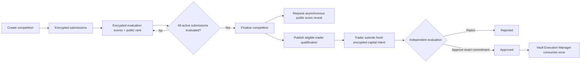
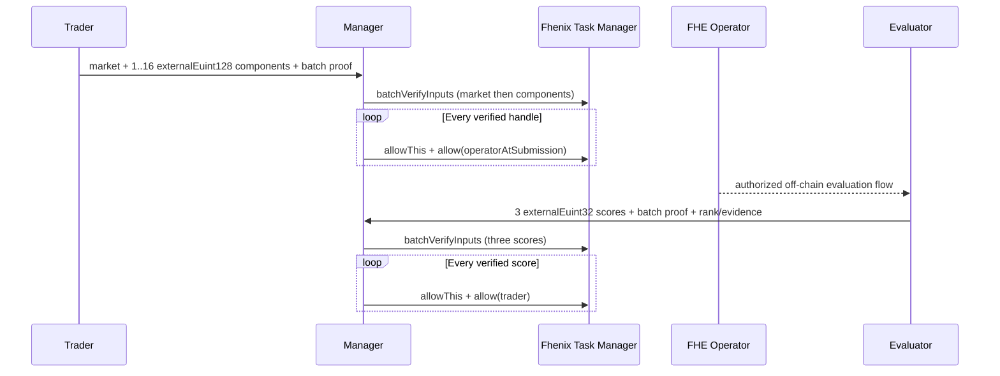

# Strategy Contracts

This module converts private strategy evidence into trader eligibility and,
later, one exact capital-execution authorization. It deliberately separates
competition from capital deployment.

## Contracts

| Contract | Responsibility |
|---|---|
| [`AlphaEngineCompetitionStrategyManager`](AlphaEngineCompetitionStrategyManager.sol) | Competition windows, encrypted submissions, encrypted evaluation scores, public ranks, finalization and score reveal |
| [`AlphaEngineTraderQualificationRegistry`](AlphaEngineTraderQualificationRegistry.sol) | Versioned, expiring and revocable trader qualification |
| [`AlphaEngineCapitalStrategyManager`](AlphaEngineCapitalStrategyManager.sol) | Fresh encrypted capital intents, independent evaluation and one-time execution commitments |

Qualification belongs to a **trader**, not a strategy. A qualified trader must
still submit a fresh encrypted capital intent, and every intent is evaluated
independently before FundVault execution can occur.

## Lifecycle

Competition states are `Active -> Evaluating -> Finalized` or `Cancelled`.
A submission ends as `Cancelled` or `Evaluated`. Capital intents end as
`Cancelled`, `Rejected`, `Consumed`, `Revoked`, or `Expired` after their
applicable transition.

## FHE use

The managers store canonical handles and hashes; they do not run encrypted
strategy simulation or FHE arithmetic. `externalEuint128` batch loading verifies signed
encrypted input and ACL metadata. It is not large-bit encrypted computation.

Competition evaluations contain three encrypted score components:

- real-sister performance;
- perturbation P25;
- stress P25.

During competition, scores are available only to the contract and their
trader. After finalization, `SCORE_REVEALER_ROLE` may call
`requestCompetitionScoreReveal` in rank-order batches of at most eight
submissions. Start at `scoreRevealedThrough(competitionId) + 1`; each rank can
be authorized once. Calls across all competitions share a five-second interval
(`nextScoreRevealAt`). It grants `FHE.allowPublic` on each score; a decrypting client
obtains and publishes the signed result asynchronously, and
`getPublicEvaluationScores` returns a separate readiness flag for every score.
No aggregate score is stored.

Capital scores have no public-reveal path.

## Critical bounds and controls

| Control | Bound/behavior |
|---|---|
| Components per submission | 1 to 16 |
| Active submissions per competition | 256 |
| Active submission per trader/competition | One; cancellation allows a new nonce |
| Score-reveal request | 8 submissions / 24 handles maximum; once per rank; five-second global interval |
| Capital authorization window | 1 hour maximum |
| Qualification | Versioned, expiring and revocable |
| Capital execution | Exact approved manager, vault, executor, calls, limits, evidence, nonce and expiry |

Operator rotation affects only future submissions because previously granted
ciphertext access cannot be revoked. Incident response therefore pauses new
work, rotates the operator, invalidates pending work where possible, and
requires fresh encryption.

## Security properties

- Competition, qualification and capital maintain independent storage and
  authority domains.
- Nonces increase only after successful submission.
- Ranks are nonzero, unique and bounded by active submissions.
- Finalization requires every active submission to be evaluated.
- Qualification cannot be published before finalization or above the cutoff.
- Revocation/requalification changes the qualification version, so an old
  capital intent cannot become valid again.
- Capital approval is immutable; changing any field requires a fresh intent.
- Capital execution is consumed once and the manager holds no token custody or
  arbitrary-call authority.

Focused tests live in [`test/unit/`](../../test/unit/),
[`test/invariant/`](../../test/invariant/), and
[`test/integration/`](../../test/integration/). For the complete property list,
see the [invariant ledger](../../docs/engineering/invariant-ledger.md).
