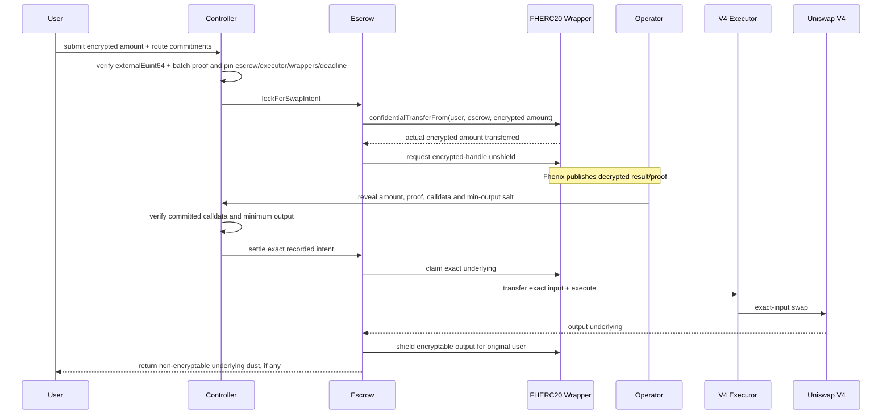
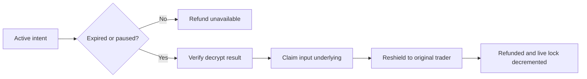

# Confidential Swap Contracts

Confidential swap is AlphaEngine's optional user-facing swap surface. It is
separate from strategy competition and FundVault execution: LP capital never
passes through this controller or escrow.

The amount is confidential while represented as FHERC20 and submitted to the
protocol. Public DEX settlement still requires the authorized operator to use
the verified decrypted input, and the resulting on-chain execution effects are
public.

## Components

| Component | Responsibility |
|---|---|
| [`AlphaEngineConfidentialSwapController`](AlphaEngineConfidentialSwapController.sol) | Intent identity, committed route/minimum output, nonce, deadline, operator and terminal status |
| [`AlphaEngineConfidentialSwapEscrow`](AlphaEngineConfidentialSwapEscrow.sol) | Temporary FHERC20 lock, unshield claim, settlement, refund and custody accounting |
| [`AlphaEngineConfidentialAssetRegistry`](../fherc20/AlphaEngineConfidentialAssetRegistry.sol) | Append-only canonical wrapper/underlying association; no custody |
| [`AlphaEngineConfidentialAssetGateway`](../fherc20/AlphaEngineConfidentialAssetGateway.sol) | Non-custodial shield and ordinary request/claim convenience |
| [`AlphaEngineFHERC20ERC20Wrapper`](../fherc20/AlphaEngineFHERC20ERC20Wrapper.sol) | Official Fhenix v0.4.0 wrapper plus constant-time claim ID lookup |
| [`AlphaEngineV4SwapExecutor`](../executors/AlphaEngineV4SwapExecutor.sol) | Escrow-only Uniswap V4 exact-input execution |

The **escrow** owns temporary custody and settlement bookkeeping. The
**executor** only performs the protocol-specific swap after receiving exact
underlying input from escrow; it neither stores intent state nor chooses the
route.

## Successful flow

At submission, the user commits to:

- input and output wrappers;
- opaque route key;
- `keccak256(executionData)`;
- a salted minimum-output commitment;
- encrypted input amount and deadline.

The current escrow and executor are recorded in the intent. The swap operator
may reveal and execute only those committed values before expiry.

New submissions are admitted through a global decrypt budget before the FHE
input is verified: at most 120 per trailing minute, with two tokens refilled
per second and a 24-request burst allowance initially. Only one intent may be
active for each trader. Delayed governance may tune these limits while paused;
they do not prevent settlement or refund. On Arbitrum, several blocks may share
a timestamp, so those blocks spend the same burst allowance.

The registry supplies explicit minimums per input wrapper in confidential units.
The controller masks below-minimum encrypted requests to zero before transfer;
insufficient balance also produces zero. Verified zero refund starts a five-minute
cooldown on the recorded trader. The first invalid request still needs decryption.

Ordinary partial unshield has a separate per-wrapper minimum, one pending/source/
wrapper, a five-minute verified-zero cooldown and a registry-wide budget initially
1/s with burst eight. Plaintext amounts below minimum reject; encrypted amounts
are masked to zero. Caller-only `unshieldAll` permits dust recovery with the same
pending/budget gates and a cooldown from admission. The explicitly registry-bound
swap escrow is exempt because controller admission governs its separate traders.
Claims and refunds remain available during admission limits. See the
[complete policy](../../docs/engineering/fhenix-decrypt-pressure-remediation.md),
including the inherited disclosure boundary and deployment configuration.

## Refund flow

Refund is permissionless after expiry, while the recorded controller/escrow
is paused, or before expiry with a verified zero result. Escrow verifies and
claims the unshielded input, then reshields any nonzero amount to the original
trader. A valid encrypted-zero transfer can therefore release the trader's
active slot as soon as its zero result is published.

## FHE and privacy boundary

- The controller internalizes one `externalEuint64` with a batch-of-one proof, grants access to itself and the
  recorded escrow, then stores only canonical handles/hashes.
- FHERC20 transfer, mint and burn use the pinned official dependency's bounded
  `euint64` comparison, select, add and subtract operations.
- Unshield makes the returned encrypted handle public for asynchronous
  decryption; settlement verifies the decryption proof before transferring
  underlying.
- No encrypted division is used. Wrapper `rate` conversion and dust arithmetic
  are ordinary plaintext Solidity.
- The swap operator learns the decrypted input needed for execution. Public
  DEX execution exposes normal settlement effects; AlphaEngine does not claim
  to hide public pool state changes.

## CoFHE 0.2 / FHERC20 0.4 boundary

Transfers and unshielding pass `FHE.shareEuint64(handle, wrapper)` and consume
returned shares with `FHE.receiveEuint64FromCall(result, wrapper)`. The escrow
persistently allows stored handles. The controller-to-escrow call remains
restricted to the configured controller and uses its existing explicit ACL grant.

An unshield ciphertext is **not** its claim ID. The escrow stores both, and its
request event exposes both; gateway unshield returns/emits both. Clients decrypt
the handle and claim by ID. Reconciliation verifies the claim's ID, recipient,
handle and proven amount. Old wrappers must be drained before a fresh cutover.
See the [migration guide](../../docs/engineering/cofhe-v020-migration.md).

## Wrapper rate and dust

The wrapper rate converts between underlying decimals and FHERC20's capped
encrypted precision. For example, if only six output decimals are encryptable,
the escrow shields the largest exact multiple of the rate and transfers the
remaining underlying dust directly to the original trader. It never silently
retains or rounds away that value.

## Security properties

- Controller and escrow status remain in parity; terminal intents cannot be
  replayed.
- The escrow stores the FHERC20's **actual returned transfer handle**, not the
  user's requested handle.
- Escrow/registry rotation is blocked while a live lock exists.
- Input/output wrapper, executor, calldata hash, minimum output and deadline
  cannot be substituted by the operator.
- Minimum-output failure reverts the entire settlement transaction.
- Output and refund always return to the recorded original trader.
- Gateway, escrow and V4 executor retain no residual underlying after a
  successful completed flow.
- The V4 executor accepts only its authorized escrow, exact input and no native
  currency.

Deferred release-hardening hypotheses are documented in the
[canonical plan](../../docs/engineering/strategy-manager-fund-vault-implementation-plan.md#deferred-confidential-swap-hardening-todos).
Focused unit, fuzz, invariant and PoolManager differential tests live under
[`test/`](../../test/).
