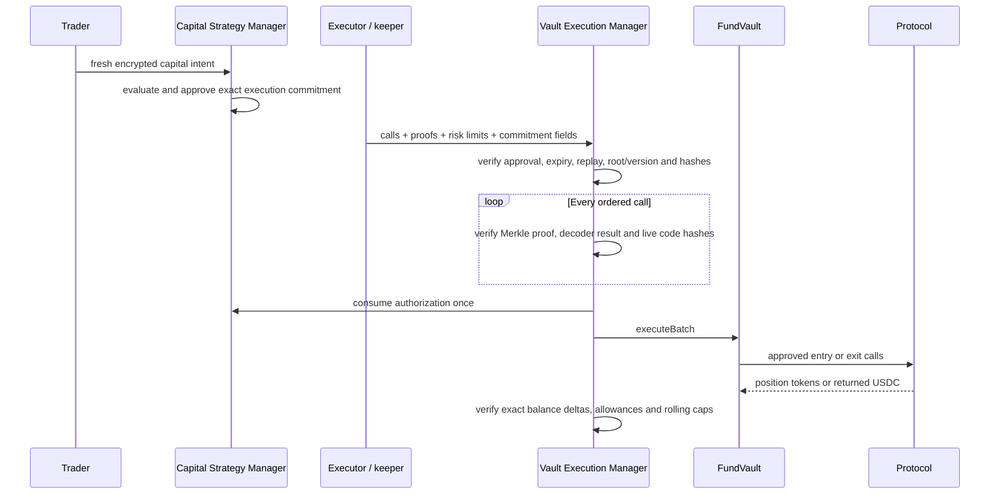

# USDC FundVault Contracts

The vault stack accepts one deposit asset—USDC—while keeping custody, user
accounting, strategy approval, and protocol execution in separate contracts.
This entire module uses ordinary Solidity; it contains **no FHE operations**.

## Components

| Component | Responsibility |
|---|---|
| [`AlphaEngineFundVault`](AlphaEngineFundVault.sol) | USDC/position custody, ERC20 share ledger, manager-only settlement and execution-manager-only batches |
| [`AlphaEngineUSDCVaultManager`](AlphaEngineUSDCVaultManager.sol) | Immediate deposits, asynchronous redemption, USDC-denominated P&L, profit vesting and performance-fee shares |
| [`AlphaEngineVaultExecutionManager`](AlphaEngineVaultExecutionManager.sol) | Exact capital authorization, per-executor Merkle policy, decoder/code-hash checks, replay and trader/asset risk limits |
| [`src/decoders/`](../decoders/) | Fail-closed ERC20, ERC4626 and Pendle RouterV4 PT calldata validation |
| [`src/libraries/`](../libraries/) | Execution hashes, Merkle leaves/proofs and rolling-spend accounting |

`AlphaEngineFundVault` is the custody and share contract. The USDC manager is
the public accounting surface around it; the execution manager is the only
surface that can deploy vault assets into approved protocol calls.

## User accounting flow

```mermaid
sequenceDiagram
    participant LP
    participant Manager as USDC Vault Manager
    participant Vault as FundVault
    participant Reporter as NAV Reporter

    LP->>Manager: deposit USDC, receiver, minShares
    Manager->>Manager: preview shares at current available-assets rate
    Manager->>Vault: pull USDC and mint shares
    Reporter->>Manager: report profit/loss + epoch + reference block + hash
    Note over Manager: Profit vests linearly; loss applies immediately
    LP->>Manager: request redemption; shares locked in Vault
    Note over Vault: Capital may still be deployed; request remains pending
    Manager->>Vault: complete only after enough idle USDC exists
    Vault-->>LP: burn locked shares and transfer USDC
```

Deposits mint immediately; there is no off-chain mint queue. The initial share
rate is `1 USDC = 1e12 share units`, aligning six-decimal USDC with 18-decimal
shares. Later deposits and completed redemptions use:

```text
share price basis = availableAssets / totalSupply
availableAssets   = managedAssets - remainingLockedProfit
```

Therefore a deposit or completed redemption does not itself change the share
price apart from deterministic integer rounding.

### Profit, loss and fees

- The NAV reporter submits sequential epochs tied to strictly increasing,
  finalized reference blocks and a nonzero report hash.
- Reported profit increases managed assets but vests linearly over the
  configurable period, initialized at deployment. New depositors receive only
  the portion that vests while they hold shares.
- Loss is recognized immediately. It first cancels remaining unvested profit,
  then records a recovery balance.
- Recovery profit restores prior loss before it becomes feeable.
- The configurable performance fee is capped at 20% and applies only to
  net-new profit. Fee shares are minted after that profit finishes vesting,
  using a dilution-safe formula so protocol shares do not participate in their
  own fee.
- Redemptions are floating-price and asynchronous. Shares are locked at
  request, but assets are calculated at completion. Completion succeeds only
  when the FundVault has sufficient idle USDC; users may cancel a pending
  request.

The report hash is evidence metadata, not an oracle proof verified by the
contract. Correct USDC net-liquidation-value reporting remains a trusted
off-chain responsibility and must include positions, realized/unrealized P&L,
slippage, fees, liabilities, and expected exit costs at the declared block.

## Capital execution flow

Entry, holding, and exit are separate transactions over time. A later approved
exit returns USDC to the FundVault; pending redemptions can then be completed.



### Policy root versus capital approval

The two controls answer different questions:

- **Capital approval:** may this exact trader intent execute this exact ordered
  call bundle, during this time window, under these asset limits?
- **Merkle policy:** is each target/selector/decoder/sanitized-argument class an
  action governance has allowed for this executor?

Policy roots are stored per **executor**, meaning the keeper/automation address
that relays execution. A root does not qualify a trader and does not grant the
executor arbitrary FundVault access. Nonzero roots require a 48-hour proposal
delay; the guardian may immediately revoke a root to zero and pause.

Each proof-bound leaf includes chain, manager, vault, decoder and target,
decoder/target code hashes, selector, native-value limit and sanitized
arguments. The initial release permits no native value, `delegatecall`, generic
router, bridge, leverage, borrowing, or flash-loan authority.

## Current action surface

- finite ERC20 approve/reset;
- ERC4626 deposit, mint, withdraw and redeem with FundVault-bound
  receiver/owner checks;
- current Pendle RouterV4 direct token-to-PT and PT-to-token actions, with
  pinned router/facet identities, selector mappings, code hashes, canonical
  calldata, no aggregator/limit-order path, and FundVault receiver checks.

Stage 17 still needs pinned real-market Pendle entry, holding-time, unwind, and
redemption-liveness fork tests. Decoder support alone is not a production route
approval.

## Security properties

- Only the USDC manager can mint/burn shares or settle user entry/exit.
- Only the permanently linked execution manager can invoke a FundVault batch.
- Owner, reporter, trader, root administrator and keeper have no direct
  arbitrary-call role on the FundVault.
- Calls are capped at 16; asset limits are capped at 16 and sorted uniquely.
- Control-plane addresses cannot be batch targets.
- Commitment and nonce replay markers supplement Capital Manager consumption.
- Proofs, decoding, code hashes, exact approvals, balance deltas, minimum
  receipts, per-execution limits and exact rolling 24-hour spend are enforced.
- A failed external call or post-execution check reverts the entire transaction,
  including both replay markers.
- Stateful tests model deposit, redemption, profit, loss, entry, arbitrary
  holding time and later exit as independent actions.

See the [invariant ledger](../../docs/engineering/invariant-ledger.md) and the
focused suites under [`test/unit/`](../../test/unit/),
[`test/invariant/`](../../test/invariant/), and
[`test/integration/`](../../test/integration/).
